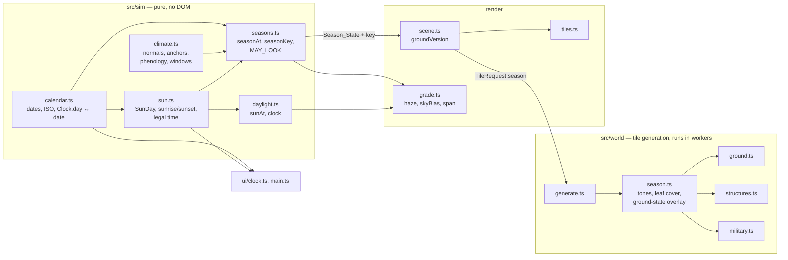

# Design Document: Seasons System

## Overview

The Seasons System turns a calendar date into two things: sunrise and sunset for the aerodrome, and a `Season_State` record that describes what the land looks like. Everything is a pure function of `(date, seed)`. Nothing is simulated while flying and no weather is added.

The design rests on five decisions.

1. **One date source.** `src/sim/calendar.ts` owns the conversion between `Clock.day` and a `Calendar_Date`. The sun, the grade, the watch, the lamps, `dateText` and the Season_State all read it. `Clock` itself (`{ day, hours }`, in solar time) does not change, so saves load unchanged.
2. **A neutral "May look" that costs nothing.** Every seasonal operation is the identity at the May-look values. Tiles generated with `Season_State = MAY_LOOK` are byte-identical to the pre-seasons world except for the June flowers and hay cocks (poppy, cornflower, clover, `hay` are 0 in `MAY_LOOK`), which is how Requirement 15.1 is met. Tiles are generated with this neutral state when no season is passed, so every existing test and tool keeps working.
3. **Placement never sees the season.** `treeAt`, `landAt`, `isWater`, `cropOf`, `structuresNear`, `tracksNear` and `frontsNear` take no season argument. Seasons change colour, canopy height and ground-state overlays only.
4. **Ground states are a 30-day fold.** Snow, frost, mud, standing water, water level and ice are computed by stepping a small daily weather model over the 30 days before the date. The weather is hidden (it is never drawn); only the accumulated ground state is exposed.
5. **Tiles regenerate on a quantised key.** The ground tile `version` includes a numeric season key built from bucketed Season_State values. A change that no one could see produces the same key, so no tiles regenerate. A visible change regenerates tiles and the existing `fadeMs` cross-fade hides the swap.

### Research summary

| Topic | Finding | Use in design |
|---|---|---|
| Lille-Lesquin monthly normals (1991–2020, Météo-France, as tabulated on [Wikipedia: Lille](https://en.wikipedia.org/wiki/Lille)) | Daily mean °C Jan→Dec: 4.1, 4.7, 7.5, 10.5, 13.8, 16.7, 18.9, 18.8, 15.8, 11.9, 7.6, 4.7. Daily max Jan 6.6, Jul 23.7. Daily min Jan 1.7, Jul 14.2. Precipitation mm: 58.2, 50.8, 52.1, 45.3, 61.6, 63.7, 67.8, 71.3, 56.8, 64.1, 75.0, 73.3 (year 740). Days ≥1 mm: 11.2, 10.6, 10.1, 9.2, 9.5, 9.8, 9.9, 9.9, 9.7, 10.8, 13.3, 12.2. Snowy days: 4.2, 5.2, 3.0, 1.0, 0.1, 0, 0, 0, 0, 0, 1.4, 3.7 (year 18.6). Record lows reach −19.5 °C. | The Climatology table (`climate.ts`). Lille is about 100 km from Ypres and in the same oceanic regime, so it is the nearest published station. Marked `[VERIFY]` as a stand-in for Ypres and as a modern (1991–2020) climate standing in for 1915. |
| Sun times | I computed sunrise and sunset at 50.85° N with the NOAA general solar position formulas (Spencer series for declination and equation of time) and a sun-centre altitude of −0.833°. Results are in the table below. | Fixes the numbers for Requirement 5 and exposes three requirement figures that need correcting (see "Requirement notes"). |
| Legal time | France moved to GMT on 11 March 1911 ([Nature 1911](https://www.nature.com/articles/086092b0)). French summer time began in the night of 14–15 June 1916 ([Archives 71](https://www.archives71.fr/decouvrir/apprendre-et-se-divertir/zooms/zooms-archives/a-la-bonne-heure-)). The 1917 and 1918 periods exist ([Langlois](https://langloishg.fr/2016/03/26/lheure-dete-pendant-la-premiere-guerre-mondiale-14-juin-1916/): "second application: 1917; third application: 1918"). I found no source for exact end dates. | A small `SUMMER_TIME` table in `sun.ts`, every end date marked `[VERIFY]`. The campaign clock reaches July 1917 (day 800), so 1917 and 1918 rows are included. |
| Phenology | No northern-France source found beyond the baselines already in the requirements. | Dates stay as tuning values with `[VERIFY]` in the code header and in `docs/HISTORICAL_RESEARCH.md`. |

Sun times computed for 50.85° N, 2.88° E, in solar time (content derived from the NOAA formulas; the 12 reference dates for the test must still be read from the NOAA calculator itself during implementation):

| Date | Sunrise | Sunset | Day length | Existing `sunsetHour` | Equation of time |
|---|---|---|---|---|---|
| 21 Jan | 07:41 | 16:19 | 8 h 39 | 16:13 | −10.6 min |
| 21 Apr | 04:56 | 19:04 | 14 h 08 | 18:58 | +1.2 min |
| 10 May | 04:23 | 19:37 | 15 h 13 | 19:31 | +3.8 min |
| 21 Jun | 03:44 | 20:16 | 16 h 31 | 20:09 | −1.3 min |
| 21 Jul | 04:03 | 19:57 | 15 h 53 | 19:49 | −6.3 min |
| 25 Sep | 05:57 | 18:03 | 12 h 05 | 17:52 | +8.4 min |
| 21 Oct | 06:47 | 17:13 | 10 h 27 | 17:01 | +15.5 min |
| 21 Dec | 08:02 | 15:58 | 7 h 56 | 15:51 | +2.2 min |

### Requirement notes (where the design departs from, or sharpens, a requirement)

These need a decision from the requirements owner; the design assumes the stated resolution.

- **5.4 (day length).** The requirement says about 7 h 45 min on 21 December. With the −0.833° definition in 5.2 the value is 7 h 56 min (7 h 43 min is the old 0° definition). The design uses 7 h 56 min ±10 min and 16 h 31 min ±10 min. The 21 June figure of 16 h 35 min is fine.
- **5.6 (10 May sunset within 3 min of today).** Impossible with 5.2: the −0.833° definition moves sunset 6 minutes later (19:31 → 19:37). The design relaxes this to within 8 minutes and updates the "~19:30 solar" note in `docs/TECH.md` to 19:37.
- **7.6 (clock window 05:00–22:00).** `advanceClock` has no window to clamp to; `DAYLIGHT.rate` only sets speed (17 h in 12 real minutes). The criterion reduces to "the longest day (16 h 31 min) is under 17 h", which holds. The test checks day length ≤ 17 h on every date.
- **9.6 vs 15.1 (hay cocks on 10 May).** Today's May tiles contain hay cocks, but 9.6 says hay cocks appear only from late May or June. The Reference_Date must look as today, so the design blends the whole Season_State from `MAY_LOOK` into the computed state over 7 days either side of 10 May (see "Reference blend"). Hay cocks are present on 10 May, fade out of the tiles by 17 May and return in the haymaking window. Requirement 4.6 only mentions the Anomaly fading in after the date; the design applies the same fade to the whole state, and also before the date so the state is continuous.
- **4.7 (Anomaly from year and week).** Weekly steps would make day-to-day jumps that break 2.4. The design samples `valueNoise` along a continuous day index (one lattice cell = 14 days), so the Anomaly still comes from `noise.ts` and still differs week to week and year to year, without steps.
- **17.1 (`?date=` replaces the Campaign_Day).** The override sets the date at which `clock.day` is 0; the clock then advances from it. Dates keep running across midnight and the season follows.
- **11 (rivers).** `ground.ts` has no rivers, only lakes. Ice and shore rules apply to lakes. A river added later reuses the same depth proxy.
- **2.4 (`daylength` bound).** `daylength` is in hours (its range is 7 to 17), the bound 0.1 applies per day in those units. The largest real change is about 4 minutes a day (0.07 h).

## Architecture



Dependency rule: `world/*` imports the `Season_State` *type* and `MAY_LOOK` from `sim/seasons.ts` and nothing else from `sim/`. `sim/*` imports nothing from `world/` or `render/` (requirement 15.7). The worker receives a plain object, so no module state crosses the thread boundary.

### The per-request look (like `DEV`)

`generate.ts` already hands per-request settings to the layers through the module-level `DEV` object (`applySettings`). Season follows that pattern: `generateTile` calls `setLook(req.season ?? MAY_LOOK)` once, and `world/season.ts` exposes the derived tone tables as module constants read by `ground.ts`, `structures.ts` and `military.ts`. Workers handle one request at a time, so a module-level look is safe. The alternative, a `look` parameter on every function in about 1,800 lines of `structures.ts` and `military.ts`, is a far larger diff for no behavioural gain. The trade-off: functions read hidden state, so tests that call `groundAt` directly get the neutral look unless they call `setLook`. A test helper `withLook(state, fn)` sets and restores it.

### Reference blend

```
w(d)    = smooth(|dayNumber(d) − dayNumber(10 May 1915)| / 7)             // 0 on 10 May 1915, 1 from 7 days either side
state   = lerp(MAY_LOOK, computed(d), w(d))                              // field by field; discrete fields take the nearer end
```

`lerp` is field-wise for numbers (including every entry of `cropStages` and `bloom`). `computed` already carries the Anomaly at full strength, so the blend zeroes the Anomaly on the reference date as 4.6 requires. Beyond 7 days the blend is exactly 1 and `computed` is returned unchanged.

## Components and Interfaces

### `src/sim/calendar.ts` (new)

```ts
export type CalDate = { year: number; month: number; day: number };            // month 1–12
export const REFERENCE: CalDate;                                                // 1915-05-10
export function dayNumber(d: CalDate): number                                   // days since 1900-01-01 (proleptic Gregorian); throws CalendarError
export function fromDayNumber(n: number): CalDate
export function dateOf(clockDay: number, start?: CalDate): CalDate              // start defaults to REFERENCE (or the ?date= override)
export function dayOfYear(d: CalDate): number                                   // 1..366
export function parseISO(s: string): CalDate                                    // throws CalendarError naming the field
export function formatISO(d: CalDate): string
export class CalendarError extends Error { field: 'year' | 'month' | 'day' | 'format' }
```

Day arithmetic uses the standard days-from-civil algorithm on integers, so there is no `Date`, no time zone and no wall clock. `dateText` in `main.ts` and `campaignDate` in `game/state.ts` call `dateOf`; `campaignDate` keeps its string return and its `natural(day)` validation, and a test compares both against the old `Date.UTC` implementation for days −200 to 800.

`campaignDate` currently rejects negative days (`natural`). Requirement 1.4 needs negative days in the calendar module only. The calendar function accepts any integer; the game-state validation is untouched.

### `src/sim/sun.ts` (new)

```ts
export const LOCATION = { name: 'Ypres', latitude: 50.85, longitude: 2.88 };    // degrees, east positive
export type SunDay = {
  date: CalDate;
  declination: number;   // radians, at local noon of the date
  eqTime: number;        // minutes (apparent − mean solar time)
  sunrise: number;       // solar hours; sun centre at −0.833°
  sunset: number;
  noonElevation: number; // radians
};
export function sunDay(date: CalDate, loc = LOCATION): SunDay                    // memoised on the last date
export const legalOffset: (utcDayNumber: number, utcHours: number) => 0 | 1     // from SUMMER_TIME
export function legalHours(day: SunDay, solarHours: number): number             // 0 ≤ h < 24
export function solarHours(day: SunDay, legalHours: number): number
export const HORIZON_ALT = -0.833 * (Math.PI / 180);
```

Formulas (NOAA general solar position, fractional year γ = 2π/365·(dayOfYear − 1), or /366 in a leap year):

- declination = 0.006918 − 0.399912 cos γ + 0.070257 sin γ − 0.006758 cos 2γ + 0.000907 sin 2γ − 0.002697 cos 3γ + 0.00148 sin 3γ
- eqTime (min) = 229.18 (0.000075 + 0.001868 cos γ − 0.032077 sin γ − 0.014615 cos 2γ − 0.040849 sin 2γ)
- hour angle at the horizon: cos H = (sin(−0.833°) − sin φ sin δ) / (cos φ cos δ); sunrise = 12 − H/15, sunset = 12 + H/15 (solar hours)

At latitude 50.85° the argument of `acos` stays inside [−1, 1] all year (the sun never stays up or down), so there is no polar branch. A clamp is kept anyway to prevent a `NaN` from a rounding overshoot.

**Legal time.** Solar time → UTC: `utc = solar − longitude/15 − eqTime/60`. Legal = UTC + `legalOffset`, wrapped to [0, 24). The offset comes from `SUMMER_TIME`, a list of `{ from: UTC instant, to: UTC instant, verify: boolean }` rows. Row 1 starts at 23:00 UTC on 14 June 1916, which gives the one-hour step the watch must show (6.7). The 1916 end, and the 1917 and 1918 rows, are `[VERIFY]`. Legal → solar is the inverse; it is exact outside the transition hour, which is why the round-trip property excludes the instants within one hour of a transition.

### `src/sim/daylight.ts` (changed)

- `dayOfYear(c: Clock)` and the 365-day wrap are removed. Callers use `sunDay(dateOf(c.day))`.
- `sunAt(day: SunDay, hours)` replaces `sunAt(dayOfYearN, hours, latitude)`. It reads `declination` from the `SunDay` and the latitude from `LOCATION`. It adds one field, `span: number`, defined as `REFERENCE_NOON_ELEVATION / day.noonElevation` (1 on 10 May 1915, about 3.6 on 21 December). `horizonMinutes` keeps its existing expression (minutes from `sunset` in the evening, from `24 − sunset` before dawn) but reads the date's `SunDay`.
- `sunsetHour(day: SunDay)` returns `day.sunset`.
- `DAYLIGHT.latitude` and `startDayOfYear` are removed (latitude moves to `LOCATION`; the start date is `REFERENCE`). `startHour` and `rate` stay.
- `shadowStrength`, `clockPace`, `strength` are unchanged (7.3). `clockPace` still treats elevation 1° as its centre; with the horizon now at −0.833° this slows the clock about 1.8° earlier than before, which is under one real second and not worth a second tuning constant.

Callers to update: `main.ts`, `story/dev.ts`, `perf.ts`, `snap.ts`, `render/scene.ts` (through `sunNow`), `game/state.ts` (reads `DAYLIGHT.startDayOfYear`).

### `src/sim/climate.ts` (new, data only)

```ts
export const NORMALS = {            // Lille-Lesquin 1991–2020, source and unit per row (header comment)
  meanC:   [4.1, 4.7, 7.5, 10.5, 13.8, 16.7, 18.9, 18.8, 15.8, 11.9, 7.6, 4.7],  // °C
  rangeC:  [4.9, 5.6, 7.4, 9.1, 9.1, 9.2, 9.5, 9.7, 8.8, 7.0, 5.4, 4.7],         // max − min, °C
  precipMm:[58.2, 50.8, 52.1, 45.3, 61.6, 63.7, 67.8, 71.3, 56.8, 64.1, 75.0, 73.3],
  wetDays: [11.2, 10.6, 10.1, 9.2, 9.5, 9.8, 9.9, 9.9, 9.7, 10.8, 13.3, 12.2],   // days ≥ 1 mm
};
export const ERA_OFFSET_C = -0.8;   // 1915 vs 1991–2020 [VERIFY: a guess, no source]
export type Anchor = { id: string; from: CalDate; to: CalDate; source: string; status: 'sourced' | 'verify'; applies: boolean; bias: AnchorBias };
export const ANCHORS: readonly Anchor[];
export const PHENOLOGY: {...};      // bud day, autumn day, harvest windows, bloom windows, haymaking window
export function checkAnchors(list: readonly Anchor[]): string[]   // messages, [] when valid (4.8)
```

Daily temperature at day-of-year `n` interpolates the monthly means smoothly (periodic, smoothstep between mid-month values). `rangeC` is derived from the max and min rows. The `NORMALS` and `PHENOLOGY` blocks carry, per row, a source string and unit in the header comment (3.6); any value not from northern France carries `[VERIFY]` (3.7).

`Anchor.bias` has three optional parts: `temp` (°C added), `wetProb` and `wetAmount` (multipliers on wet-day probability and amount), and `force` (a day on which the daily weather is set outright, used for 22 November 1914). The table:

| id | dates | bias | status |
|---|---|---|---|
| `wet-winter-1914-15` | 25 Oct 1914 – 31 Mar 1915 | `wetProb ×1.35`, `wetAmount ×1.3` | `verify` (Guardian pieces cited, not yet read in full) |
| `snow-1914-11-22` | 22 – 23 Nov 1914 | `force: heavy precipitation at −1 °C` | `verify` |
| `wet-dec-1915` | 1 – 31 Dec 1915 | `wetProb ×1.4`, `wetAmount ×1.25` | `verify` (The Times page partly unreadable) |
| `loos-1915` | 25 Sep – 15 Oct 1915 | none | `verify`, `applies: false` |

The Reference_Date "anchor" is the blend, not a row, because its effect is on the whole Season_State rather than on the weather model.

### `src/sim/seasons.ts` (new)

```ts
export type SeasonState = {
  date: CalDate; doy: number;
  daylength: number;                       // hours, 7–17
  foliage: number;                         // 0–1  species-average leaf cover
  budding: number;                         // 0–1  pale-green bud-burst share
  autumnColour: number;                    // 0–1
  leafDays: number; fallDays: number;      // days since this year's bud burst / autumn colour start (negative = before); drive per-tree timing
  grassGreen: number;                      // 0–1
  cropStages: Record<CropName, number>;    // 0 bare · 1 blades · 2 green · 3 ripe · 4 stubble (continuous, 0–4)
  bloom: Record<BloomKind, number>;        // 0–1 per kind; multiplies the existing spatial bloom
  hay: number;                             // 0–1 haymaking
  snow: number; frost: number; mud: number; standingWater: number; ice: number;   // 0–1
  waterLevel: number;                      // 0–1, 0 = the existing May shore
  haze: number;                            // 0–1
  skyBias: number;                         // −1 (winter) … +1 (summer), 0 on the Reference_Date
};
export const MAY_LOOK: SeasonState;        // the neutral state (see below)
export function seasonAt(date: CalDate, seed: number): SeasonState        // memoised, ≤ 64 entries
export function seasonKey(s: SeasonState): number                        // 31-bit hash of bucketed values
export function applyOverrides(s: SeasonState, o: Partial<...>): SeasonState
```

**`MAY_LOOK`**: `foliage 1, budding 0, autumnColour 0, grassGreen 1`, every crop at stage 2 (the colours the CROPS table has now; colza "in flower" is stage 2), `bloom` all 1, `hay 1`, `snow, frost, mud, standingWater, ice, waterLevel, haze, skyBias` all 0, `leafDays` large positive (full leaf), `fallDays` large negative.

**Computation of one date**, in order:

1. *Year-level draws* from `hash(seed + 510 + k, year, 0)`: bud-burst day (centre 17 April, ±7 days; 3.3), autumn-colour start (centre 27 September, ±6 days), harvest shift (±5 days), bloom-window shifts (±6 days, per kind).
2. *Foliage.* `leafDays = doy − budDay`. Species-average cover is `smooth(leafDays / 18) × (1 − smooth((fallDays − 14) / 36))`; `budding = 4·c·(1−c)` where `c = smooth(leafDays/18)`; `autumnColour = smooth(fallDays / 20)`. Spans of 18, 20 and 36 days keep the per-day change under 0.1 (the steepest part of a smoothstep over `s` days changes 1.5/s per day).
3. *Crops.* Each crop kind has anchor days and stages (cyclic, piecewise linear, year-shifted). Winter wheat: bare 1 Nov → blades 1 Dec → green 15 Mar → tall 10 May → ripe 15 Jul → stubble 10 Aug → ploughed (0) 15 Oct. Colza: green all winter, flower 10 Apr – 25 May (stage 2 is "in flower"), ripe 5 Jul, stubble 25 Jul. Spring-sown (young flax, red clover): bare until 10 Apr, green 1 May, ripe 20 Aug, stubble 15 Sep. `ploughed` stays at 0. Meadow, pasture, rough grass follow `grassGreen` (below), not stages. All dates are `[VERIFY]`.
4. *Grass.* `grassGreen = 0.25 + 0.75·smooth((meanT14 − 3) / 9)`, where `meanT14` is the 14-day mean of the climatological temperature plus Anomaly. It is 1 from late April on.
5. *Bloom and hay* use trapezoid windows (10-day ramps) over the day ranges in the table below, shifted by the year draw.
6. *Ground states*, from the 30-day fold (next section), then the cap for requirement 10.9.
7. *Haze and skyBias.* `skyBias = −cos(2π (doy − 12) / 365)`, adjusted so it is 0 on 10 May (the curve is shifted and scaled so the Reference_Date maps to 0, winter is −1 and midsummer is about +0.9). `haze = 0.6·wetness14 × (cold factor)` using the same 14-day wetness as `mud`; range 0–0.6.
8. *Blend* with `MAY_LOOK` (Reference blend above).

Bloom and hay windows (`[VERIFY]` for every row, 9.5, 9.6):

| Kind | Window (day of year) | Kind | Window |
|---|---|---|---|
| bluebell | 105 – 140 | hawthorn | 120 – 150 |
| cowParsley | 125 – 175 | colza | 100 – 145 |
| buttercup | 110 – 230 | daisy | 130 – 250 |
| poppy | 145 – 215 | cornflower | 155 – 220 |
| clover | 150 – 260 | hay cocks | 152 – 190 |

**The 30-day fold.** For date `d`, step days `d−30 … d` in order from an initial state set to the climatological equilibrium of day `d−30`:

```
weatherDay(n, seed) → { t, tmin, rain }                        // pure, cached per day number
  t     = normalMean(doy) + ERA_OFFSET + 3.5·(valueNoise(seed+520, n/4, 0) − 0.5)·2 + anchor.temp
  tmin  = t − rangeC(doy)/2
  wet   = hash(seed+521, n, 0) < wetProb(doy)·anchor.wetProb
  rain  = wet ? min(1, −ln(1 − 0.95·hash(seed+522, n, 0))·meanMm(doy)·anchor.wetAmount / 15) : 0

step(g, w, doy):
  snowfall = (w.t < 1.5) ? w.rain : 0
  rainfall = (w.t ≥ 1.5) ? w.rain : 0
  snow  = slew(g.snow,  g.snow + 0.9·snowfall − 0.12·max(0, w.t) / 3, ±0.35)
  mud   = slew(g.mud,   g.mud·dry(w.t) + 0.5·rainfall + 0.15·melt, ±0.35)  × (frozenHard ? 0.5 : 1)
  water = slew(g.water, g.water·dry2(w.t) + 0.25·rainfall + 0.1·melt, ±0.35)
  level = g.level·0.93 + 0.2·w.rain                                          // slow, 0–1
  ice   = slew(g.ice,   g.ice + 0.12·max(0, −w.t) − 0.15·max(0, w.t), ±0.35)  // freezing-degree-days
  frost = slew(g.frost, (w.tmin < 0 && snow < 0.3) ? smooth(−w.tmin / 4) : 0, ±0.35)
```

`dry(t)` is the daily retention: 0.95 below 5 °C, falling to 0.86 above 15 °C (evaporation). `slew(prev, target, max)` limits one day's change, which makes 2.5 hold by construction for every ground state. All states are clamped to [0, 1]. A snowfall's `0.9·rain` makes a single big day add about 0.35 at most after the slew, which is the "snowfall can arrive within a day" behaviour.

**Caps (10.9).** After the fold, `snow`, `ice` and `frost` are multiplied by `cap(d)`: 0 from 1 May to 30 September, 1 from 15 October to 15 April, with linear ramps between. The ramp rate is under 0.07 a day, inside every bound. `cap` is applied after the fold so that a late snow in mid-April still melts through the ramp rather than vanishing.

**Calibration.** The constants above (3.5 °C day-to-day spread, 0.9 snow factor, 0.12 melt) are starting values. The budget tests (below) assert snow above 0.05 on under 15% of days and frost above 0.05 on at most 70 days a year, and fail with the counts if tuning drifts. Rough estimates from the normals: about 45 frost days and 15–25 snow-cover days.

**Cache.** `seasonAt` keeps a `Map<number, SeasonState>` keyed on `dayNumber·2^31 + seed` with at most 64 entries (oldest dropped), plus a `weatherDay` cache of 64 days. A new date costs 31 weather evaluations plus the fold, a few microseconds. The record for `d` never uses the record for `d−1`, so a cache hit or miss gives the same value (requirement 2.7).

**`seasonKey`.** Bucket each value and hash: `foliage·16, budding·8, autumnColour·8, grassGreen·8, each cropStage·4, each bloom·4, hay·4, snow·10, frost·6, mud·8, standingWater·8, waterLevel·6, ice·8`. `haze` and `skyBias` are not in the key because they affect only the grade, which has its own repaint key. The bucket sizes are the "smallest visible step" of 16.4; they are tuning constants in `seasons.ts`.

### `src/world/season.ts` (new)

The only module in `world/` that knows what a season looks like. It holds the tone families and the ground-state overlay.

```ts
export function setLook(s: SeasonState): void                    // per request, builds the tone tables once per tile
export const look: { s: SeasonState; ... }                        // read by ground.ts, structures.ts, military.ts
export function leafCover(species: number, treeId: number): { cover: number; autumn: number; bud: number }
export function crowns(species: number): readonly (readonly [RGB,RGB,RGB,RGB])[]   // season-tinted SPECIES tones
export function cropTones(cropIndex: number): readonly [RGB, RGB]
export function grassTones(a: RGB, b: RGB): readonly [RGB, RGB]
export function overlay(seed: number, x: number, y: number, c: RGB, h: number, kind: Surface): RGB
```

**Tone helpers.** `tone(c, target, t)` returns `c` itself (same array) when `t <= 0` and an interned blended `RGB` otherwise (blend `t` rounded to 1/16, memoised in a `Map` per `setLook`), so a neutral tile allocates nothing and keeps the identity comparisons that `groundChunk` uses for glints (`c === WATER.deep`).

**Trees (8.1–8.7).** Each tree has a species offset (oak +6 days, pale poplar/birch −6, dark elm 0, so the species change on different days) and its own offset from `hash(seed+530, treeCell)` of ±3 days, a spread of at least 5 days between early and late trees. `leafCover` returns `cover = smooth((leafDays − off)/18)·(1 − smooth((fallDays − 14 − off)/36))`, `bud`, and `autumn = smooth((fallDays − off)/20)`. In `groundAt`, the crown pixel is chosen from the species tones as follows:

- `cover < 0.5`: the pixel is drawn as the branch/trunk tone (dark brown-grey) where a dither threshold `bayer(x, y) + noise(x/2, y/2)·0.3` exceeds `cover·2`; otherwise it falls through to the ground under the crown (the existing banded and dithered pixel style, 8.5).
- otherwise the species tone, blended toward pale green by `bud` and toward yellow, ochre and russet (three tones by hash of the tree) by `autumn`.
- the crown height becomes `HEIGHT.tree·(0.4 + 0.6·cover) + bulge·cover`. At `cover = 1` this is today's height, so shadows are thinner when bare (8.6). The same `cover` lowers `HEIGHT.hedge` for hedges.
- below `foliage 0.3`, the forest floor and the ground under crowns (a radius `r·1.2` ring from `treeAt`) use leaf-litter tones (8.7), a brown extension of `FLOOR.litter`.

**Fields and flowers (9).** `cropPixel` takes its two colours from `cropTones(cropIndex)`, which interpolates from earth (stage 0) through short green blades, the existing `a`/`b` (stage 2), golden (3, `#c8a84a`/`#b8963e`) and stubble (4, `#a8955a`/`#9a8650`, drawn with `pattern: 'rows'` stripes so the lines stay visible). Meadow, pasture and rough grass call `grassTones`, which blends `a`/`b` toward olive-brown winter tones by `1 − grassGreen`. Every `bloom(seed, x, y, kind)` call is multiplied by `look.s.bloom[kind]`. `haycockAt` multiplies `MOWN` by `look.s.hay`. The `ponytail:` comment above `FLOWER` is replaced by a pointer to `sim/climate.ts` (9.8).

**Ground-state overlay (10–13).** `overlay` is a post-pass applied once per pixel at the end of `groundChunk` (after the stamp and the ground are chosen, before the `groundShade` multiply). It is the only place snow, frost, mud, standing water and ice are applied, so structures and the front's works need no per-site code for them. Early out: if `snow, frost, mud, standingWater, ice, waterLevel` are all ≤ 0.05, it returns `c` unchanged.

`Surface` classes are derived from the colour identity and height of the pixel rather than passed in by each layer: a `Map<RGB, Surface>` of known constants (`DIRT.*`, `M.mud`, track colours, `WATER.*`, roof arrays, wire and sandbag tones) built once at module load. Everything not in the map is `field` (height 0) or `raised` (height > 0). This is a deliberate shortcut to avoid touching 1,800 lines; the limit is that a new colour added later falls into `field`/`raised` until it is registered. A `ponytail:` comment records this.

Per class, in order:

| Class | Mud (>0.05) | Standing water (>0.05) | Snow (>0.05) | Frost (>0.05, snow<0.3) | Ice (>0.05) |
|---|---|---|---|---|---|
| `field` | no change | low-lying pixels (below a `wetness` threshold that rises with `standingWater`) become `WATER.pool` tones | white / blue-grey where `snow·(1 + 0.6·shelter) > patch(x,y)` | pale speckle, strongest where `shelter` is high | water pixels become pale grey-white with cracks |
| `dirt` (tracks, yards, margins, ruts, `M.mud`) | darker `DIRT.rut`-family tones with extra ruts | puddles in ruts | **kept dark**: snow only at the edges, at a fifth of the field rate (10.3) | none | puddles freeze |
| `water` (lakes) | tint toward turbid brown by `max(mud, waterLevel)` (11.2) | n/a | n/a | n/a | frozen skin from the shore inward (see below) |
| `raised` (roof, parapet, hedge top, sandbag, hay) | none | none | snow on top surfaces (see below) | rime, pale tones | none |
| `trench floor` / `dugout` | wet tones | partly flooded, share rises with `standingWater` (13.1) | **kept dark** (13.3) | none | flooded part freezes (13.5) |

`patch(x, y)` is `fbm(seed+540, x/40, y/40, 3)·0.7 + valueNoise(x/5, y/5)·0.3 + (bayer(x, y) − 0.5)·0.15`, scaled to [0, 1], so coverage share ≈ `snow`. Because the same noise is compared against an increasing threshold, the covered set grows monotonically with `snow` (property 17). `shelter` is `max(woodDensity, hedge proximity, building lee)`, where the last two come from the pixel's height neighbourhood: a pixel with a raised neighbour to its south is sheltered. The neighbourhood is approximated from the `heights` row buffer that `groundChunk` already writes (one row up and down, no extra generation work).

Roofs (12.1): `raised` pixels inside a structure stamp are recognised by their colour being in a roof array. Snow share on a roof is `snow·pitch factor` where thatch holds more (0.9) than slate (0.6) and tile (0.7); a roof pixel whose shading band is the sunny side (the lighter of its field A/B tones) melts first. Ruined walls use the `raised` rule unchanged (12.6).

Lake ice (11.3): depth proxy `depth = wet − LAKE` (0 at the shore, rising inward). Ice covers `depth < ice·0.1`, with a ragged edge from `valueNoise`, so the middle freezes last. A lake pixel deeper than `0.1` is never fully frozen.

Glints (11.4): ice pixels are not `WATER.deep/shallow`, so the existing glint test skips them. `groundChunk` adds `ICE_GLINT = GLINT·0.25` for ice pixels (a quarter of the open-water rate).

Flooded pixels (13.1): a trench pixel is flooded when `hash(seed+550, floor(x/12), floor(y/12)) < standingWater·wetness(x, y)` (a low-lying pixel floods first, the same `wetness` field the lakes use). That function is `floodShare(standingWater, wetness)`, pure and monotone in `standingWater`.

**Summer front (13.6).** With `mud < 0.1 && foliage > 0.7` the overlay returns `c`; at `MAY_LOOK` the whole path returns before touching a pixel.

### `src/world/ground.ts`, `structures.ts`, `military.ts` (edits)

- `ground.ts`: `SPECIES` is read through `crowns()`; `cropPixel`, `haycockAt`, `flowers` and `bloom` read the look as above; `groundChunk` calls `overlay` and the ice-glint rule. `WATER`, `SHORE`, `DIRT`, `FLOWER` stay exported and unchanged. The shore reeds test becomes `reeds = noise + d·0.3 > 0.8 + 0.25·waterLevel` (a higher water level drowns the reeds in mud, 11.1) and below `foliage 0.3` reeds use dry straw tones (11.5).
- `structures.ts`: seasonal farm features (4 of 12): `muck` heaps are present in the spring window, `cocks` follow `hay`, `rick`/thatched stacks follow `cropStages['young wheat'] ≥ 4`, `clamp` and `faggots` are present in winter, `hops` poles draw green bines from June to September (`foliage`). These are presence or colour changes of the existing `Bit` kinds; the plan, kind and position never change (12.5). Orchard blossom uses `bloom.hawthorn`.
- `military.ts`: no per-pixel season code. The overlay handles mud, water, snow, frost and ice on its stamps. The only edit is exporting the colour groups (`M.mud`, wire, sandbags, trench floors) that `season.ts` registers in its `Surface` map.
- `generate.ts`: `TileRequest` ground variant gains `season?: SeasonState`; `generateTile` calls `setLook(req.season ?? MAY_LOOK)`; `tileStamp`'s `under()` helper is unchanged (it calls `groundAt`, which reads the look).

### `src/render/scene.ts`, `tiles.ts`, `tilegen.ts`

- `Scene` gains `season: { state: SeasonState; key: number }`, set by `main.ts` when the date changes (same pattern as `scene.sun`).
- `groundVersion` becomes `base + 8·damageVersion + 2^6·season.key`, still a number, so the sunlight layer's `g·31 + v0` combination keeps working and the sunlight bake regenerates when canopy heights change. The ground `gen` call passes `season: scene.season.state`.
- `tiles.ts` is unchanged: its `version` and `fadeMs` already regenerate and cross-fade (16.5). `tilegen.ts` and `worker.ts` need no edit; the request is structured-cloned with the `season` object (about 40 numbers).

### `src/render/grade.ts` (changed)

- `skyFor(seed, day, evening, skyBias = 0)`: the `OVERCAST` threshold becomes `0.1 + 0.2·max(0, −skyBias)` and `beauty` is scaled by `1 − 0.15·max(0, −skyBias)`. At `skyBias = 0` the arithmetic is identical to today.
- `gradeFor(sun, sky, season?)`: `golden` and `blaze` use `el·sun.span` instead of `el` when `el > 0` (`span` is 1 on 10 May 1915), so the golden hour takes the same share of the day in every month (14.3, 7.1). `dusk` and `night` still use the real elevation. A seasonal daylight tint multiplies the `near`/`far` colours by `[0.93, 0.96, 1.0]` at `skyBias = −1` and `[1.0, 0.98, 0.92]` at `skyBias = +1`, with alpha `0.14·|skyBias|`, adding to `tintAlpha`. Its colour is blended through the existing `mix`, so it needs no new pass.
- `haze` adds a radial term to the existing `glow` pass in `gradePixels`: alpha `haze·0.25·smooth((r/R − 0.35)/0.65)` of a pale grey-blue, banded in the same `BANDS` and dithered with the same `DITHER`. It is rotation-invariant, so the painted overlay can still be rotated each frame. `Grade` gains `haze`; `active` becomes true when `haze > 0.02`; `drawGrade`'s repaint key gains `q(g.haze, 0.02)`. At `haze = 0` nothing is computed (16.7).

### `src/ui/clock.ts` and `src/main.ts` (changed)

- `TimeOfDay` gains no field, but `hours` and `sunset` passed by `main.ts` become **legal** hours (`legalHours(day, solarHours)`, `legalHours(day, day.sunset)`), so `drawClock` and `watchPx` need no change (6.5). `clockText` already prints 12-hour text from whatever hours it is given.
- `main.ts`: `dateText` calls `dateOf`; `RANDOM_HOUR` uses `sunDay(dateOf(0)).sunset` (7.5; the start hour is between sunrise and sunset because 1.75–2.25 h before a sunset that is at least 7 h 56 min after sunrise cannot fall before sunrise); a `currentSeason()` recomputes `seasonAt` when `dateOf(state.clock.day)` changes and writes `scene.season`; overrides are applied after it.
- `story/dev.ts` replaces `dayOfYear({ day, hours: 0 })` with `sunDay(dateOf(day))`.

### Overrides (`main.ts`, `devtools.ts`, `snap.ts`)

```ts
// src/sim/seasons.ts
export type Overrides = { date?: CalDate; season?: 'winter'|'spring'|'summer'|'autumn'; params?: Partial<Pick<SeasonState,'snow'|'frost'|'mud'|'standingWater'|'ice'|'foliage'|'haze'>> };
export function parseOverrides(search: string): { overrides: Overrides; problems: string[] }   // pure
```

`?date=YYYY-MM-DD`, `?season=` (21 Jan, 21 Apr, 21 Jul, 21 Oct 1915), and `?snow= ?frost= ?mud= ?water= ?ice= ?foliage= ?haze=` (0 to 1). A malformed or out-of-range value is dropped and listed in `problems`, which `main.ts` prints with `console.warn` (17.6). `applyOverrides` replaces the named fields after the date is applied. In `devtools.ts`, `archie.date(iso?)`, `archie.season(name?)` and `archie.seasonParam(name, value?)` change the overrides, set `scene.season`, and return the current value; `archie.date(null)` clears all overrides. `archie.state()` gains `date`, `season` and `overridden` (17.5). Overrides are read only when `IS_DEV || ?debug`, and `readClock` and the save schema never see them (17.7). `snap.ts` parses the same `--date= --season= --snow= …` and passes `season` to `generateTile`.

## Data Models

| Name | Shape | Notes |
|---|---|---|
| `CalDate` | `{ year, month, day }` | Proleptic Gregorian. `dayNumber` counts from 1900-01-01. |
| `SunDay` | see `sun.ts` | One per date, memoised on the last date. |
| `SeasonState` | see `seasons.ts` | Plain object of numbers and two records of numbers; structured-clone safe. |
| `Anchor` | see `climate.ts` | `status` is required; a missing status fails `checkAnchors`. |
| `TileRequest` (ground) | adds `season?: SeasonState` | Absent means `MAY_LOOK`. |
| `Clock`, save data | unchanged | Solar time. No season or override is stored. |

Ranges (2.3), checked by test: `daylength` 7–17 h; `foliage, budding, autumnColour, grassGreen, hay, snow, frost, mud, standingWater, ice, waterLevel, haze` 0–1; `bloom` entries 0–1; `cropStages` entries 0–4; `skyBias` −1–1; `leafDays`, `fallDays` finite.

## Correctness Properties

*A property is a characteristic or behavior that should hold true across all valid executions of a system-essentially, a formal statement about what the system should do. Properties serve as the bridge between human-readable specifications and machine-verifiable correctness guarantees.*

Reflection on the prework: the day-number round trip (1.1) subsumes the negative-day case (1.4); continuity bounds 2.4 and 2.5 merge into one property; the range check 2.3 and the finite-sun check 5.7 stay separate because they test different modules; the blend and neutrality (4.6, 15.1 groundwork) are one property; the elevation-at-sunrise property (5.1, 5.2, 5.5) covers the consistency between `sunAt` and `Sun_Times`; the bloom (9.5) and hay (9.6) windows merge. Criteria classified as examples (fixed dates, fingerprint, benchmarks, visual checks) are in the Testing Strategy.

### Property 1: Calendar day round trip

*For any* integer campaign day from −2000 to 40000, converting to a `CalDate` and back gives the same day, and the date equals the one obtained from a `Date.UTC` reference computation counting from 10 May 1915.

**Validates: Requirements 1.1, 1.4, 1.5**

### Property 2: Day-of-year range

*For any* valid `CalDate` from 1 January 1900 to 31 December 2100, the day of year is an integer from 1 to 366, is 366 only on 31 December of a leap year, and increases by exactly 1 from one date to the next within a year.

**Validates: Requirements 1.2**

### Property 3: ISO date round trip

*For any* valid `CalDate` from 1900 to 2100, `parseISO(formatISO(d))` equals `d`.

**Validates: Requirements 17.8**

### Property 4: Invalid dates are rejected by field

*For any* year, month or day outside the valid range of that field (including 29 February in a non-leap year), `dayNumber` throws a `CalendarError` whose `field` names the offending field.

**Validates: Requirements 1.6**

### Property 5: Season_State is a pure function of date and seed

*For any* date, seed and any sequence of other `seasonAt` calls made before it (including none, and including a cleared cache), `seasonAt(date, seed)` returns a deeply equal record.

**Validates: Requirements 2.1, 2.2, 2.7, 16.8**

### Property 6: Season_State stays in range

*For any* date from 1900 to 2100 and any seed, every `SeasonState` field is finite and inside its documented range.

**Validates: Requirements 2.3**

### Property 7: Day-to-day continuity

*For any* date and seed, between that date and the next, `foliage`, `autumnColour`, `budding`, `grassGreen`, `waterLevel` and `daylength` each change by at most 0.1, and `snow`, `ice`, `mud`, `frost` and `standingWater` each change by at most 0.35.

**Validates: Requirements 2.4, 2.5**

### Property 8: Sunrise and sunset are the −0.833° crossings

*For any* date from 1900 to 2100, `Sun_Times` are finite with `sunrise < 12 < sunset`, symmetric about solar noon, and the sun's computed elevation at `sunrise` and at `sunset` is −0.833° within the elevation change of one minute; `sunAt` at those hours reports the same crossing, and `horizonMinutes` is 0 at `sunset` within one minute.

**Validates: Requirements 5.1, 5.2, 5.5, 5.7**

### Property 9: Legal time round trip

*For any* date and any solar hour that is more than one hour from a summer-time transition, `solarHours(legalHours(h))` returns `h` within one second, and the offset between UTC and legal time is 0 or 1 hour.

**Validates: Requirements 6.1, 6.4**

### Property 10: A sortie starts in daylight and the day fits the clock

*For any* date and any start offset from 1.75 to 2.25 hours before sunset, the start hour lies between that date's sunrise and sunset, and the date's day length is at most 17 hours.

**Validates: Requirements 7.5, 7.6**

### Property 11: Phenology falls in its windows

*For any* seed and year from 1900 to 2100, the day on which `budding` first reaches 0.5 lies between 10 April and 5 May; the day `autumnColour` first exceeds 0.1 lies between 14 September and 14 October; the day winter wheat first reaches stage 4 lies between 20 July and 20 August. *For any* seed and any 30 consecutive years, the bud-burst days span at least 7 days.

**Validates: Requirements 3.3, 3.4, 3.5**

### Property 12: Cold states are zero from May to September

*For any* seed and year, `snow`, `ice` and `frost` are exactly 0 on every date from 1 May to 30 September.

**Validates: Requirements 10.9**

### Property 13: Thaw melts snow and ice

*For any* starting `snow` and `ice` and any run of days whose mean temperature is above 3 °C, `snow` and `ice` never increase from one day to the next and reach 0 within 10 days.

**Validates: Requirements 10.10**

### Property 14: Ground-state budgets

*For any* seed, over 30 consecutive simulated years, `snow > 0.05` occurs on fewer than 15% of days on average, and `frost > 0.05` occurs on at most 70 days in each year.

**Validates: Requirements 10.8**

### Property 15: Reference date is neutral and fades smoothly

*For any* seed, `seasonAt(10 May 1915, seed)` equals `MAY_LOOK`, and for `k` from 0 to 7 the blend weight `w(k)` is non-decreasing, equals 0 at `k = 0` and 1 at `k ≥ 7`, and the state for any date 7 or more days away equals the unblended computed state.

**Validates: Requirements 4.6, 15.1**

### Property 16: Bloom and hay windows

*For any* seed, year and date, each `bloom` kind and `hay` is in [0, 1], and is 0 on every date outside that kind's window widened by its year shift and ramp.

**Validates: Requirements 9.5, 9.6**

### Property 17: Per-tree leaf timing

*For any* seed and species, over any set of 50 or more trees in one wood, the day on which leaf cover reaches 0.5 spans at least 5 days between the earliest and latest tree, and for any single tree leaf cover is non-decreasing in `leafDays` before the autumn fall.

**Validates: Requirements 8.3, 8.4**

### Property 18: Placement ignores the season

*For any* seed, world point and `SeasonState`, `treeAt`, `landAt`, `isWater`, `cropOf`, `structuresNear`, `tracksNear` and `frontsNear` return the same result under the state as under `MAY_LOOK`.

**Validates: Requirements 8.8, 9.7, 11.6, 12.5**

### Property 19: Snow and flood coverage grow with their parameter

*For any* seed, tile and two values `a ≤ b` of `snow` (and likewise `standingWater`), the set of pixels covered at `a` is a subset of the set covered at `b`, and the share covered is within 0.15 of the parameter on open ground.

**Validates: Requirements 10.2, 13.1**

### Property 20: Dark features stay dark under snow

*For any* seed, tile and `snow`, every pixel of a track, trench floor or rut stamp has luminance no greater than the same pixel at `snow = 0` plus a small tolerance.

**Validates: Requirements 10.3, 13.3**

### Property 21: Every pixel has a valid colour on every date

*For any* seed, tile, and date, `generateTile` returns an opaque colour with channels 0–255 at every pixel and a finite height at every pixel.

**Validates: Requirements 13.7, 18.2**

### Property 22: Season key is a function of the bucketed state

*For any* two `SeasonState`s whose bucketed values (the quantised fields in `seasonKey`) are equal, the keys are equal; and *for any* state, `seasonKey` is deterministic.

**Validates: Requirements 16.1, 16.3, 16.4**

### Property 23: Override parsing

*For any* query string, valid values (dates and numbers 0–1) are returned unchanged and every malformed or out-of-range value is dropped, listed in `problems`, and leaves the other overrides intact.

**Validates: Requirements 17.1, 17.2, 17.3, 17.6**

### Property 24: Winter evenings are plainer

*For any* seed, the share of winter evenings (21 Dec ± 30 days, over 200 days) whose `skyFor` palette is `OVERCAST` exceeds that share for summer evenings (21 Jun ± 30 days); and `skyFor(seed, day, evening, 0)` equals the current `skyFor(seed, day, evening)`.

**Validates: Requirements 14.1, 14.2**

## Error Handling

| Condition | Behaviour |
|---|---|
| Invalid `CalDate` (month 13, 31 Feb, year out of 1900–2100 for the sun and season functions) | `CalendarError` with the field name. The game never creates one from a `Clock`; it appears for `?date=` and tools. |
| Bad `?date=`, `?season=` or parameter value | Ignored, reason logged with `console.warn`, previous value kept. The game starts normally. |
| `archie.seasonParam(name, value)` out of range or unknown name | Throws `Error` with the valid names or range, like `archie.speed` does today. |
| Anchor with no status, or `to < from`, or an unknown bias key | `checkAnchors` returns a message naming the anchor; the Seasons test fails. At runtime an invalid anchor is skipped. |
| `acos` argument outside [−1, 1] in `sunDay` | Clamped (never reached at this latitude). |
| A `TileRequest` with no `season` (old callers, tests, `snap`, `fingerprint`) | `MAY_LOOK`, so output is today's. |
| A `season` object with a missing field arriving in a worker | Fields default to `MAY_LOOK` values (`{ ...MAY_LOOK, ...req.season }`). |
| Worker failure | Existing handling in `tilegen.ts` (fall back to the main thread, tile retried). |

## Testing Strategy

**Approach.** Both kinds of test are used. Property tests cover the pure functions (calendar, sun, legal time, Season_State, key, overrides, pixel invariants). Unit and snapshot tests cover fixed dates, rendering looks, wiring and performance. Tests run under `npm run check` with `node --test`, in files next to the code (`calendar.test.ts`, `sun.test.ts`, `seasons.test.ts`, `world/season.test.ts`), following the existing `*.test.ts` layout.

**Property-based testing library.** [fast-check](https://github.com/dubzzz/fast-check), added as a **dev dependency only** (Requirement 15.5 forbids runtime dependencies, and a dev dependency does not ship). The alternative is seeded loops over `core/noise.ts` `hash`, which adds no package but means writing generators and shrinking by hand; the instructions for this workflow say not to implement property testing from scratch, so fast-check is chosen. If the project prefers no new package at all, the loops approach is the fallback and the properties stay the same.

**Property test configuration.**
- Each property is one `fc.assert(fc.property(...), { numRuns: 100 })` (more where it is cheap, for example 1000 for the calendar).
- Each test carries a comment tag: `// Feature: seasons-system, Property N: <property text>`.
- Properties 14 and 11 run on year-long loops; they use fewer runs (20 seeds) and fixed year spans to keep `npm run check` under a few seconds. Property 21 uses 5 dates × a handful of tiles per run.

**Unit and example tests.**
- *Sun times (5.3, 5.4, 5.6).* A table of 12 dates (both solstices, both equinoxes, 10 May 1915, 29 February 1916, 25 September 1915, 21 January, 21 April, 21 July, 21 October) with expected sunrise and sunset **read from the NOAA calculator during implementation**, tolerance 2 minutes. The table in this document is from the same formulas and is a cross-check, not the expected source. 21 December within 7 h 56 min ±10, 21 June within 16 h 31 min ±10, noon elevation 15.7° and 62.6° ±1°, 10 May sunset within 8 minutes of 19:31.
- *Legal time (6.2, 6.3, 6.7).* GMT on 14 June 1916 at 22:59 UTC and GMT+1 at 23:00 UTC; the one-hour step; no offset on 10 May 1915.
- *Anchors (4.1–4.5, 4.8).* `checkAnchors` accepts the shipped table and rejects one without a status, naming it. On 15 December 1914 and 10 January 1915, `mud` exceeds the no-anchor value for the same date. On 24 November 1914, `snow > 0.1`. The `loos-1915` row has no effect.
- *Climate shape (3.2, 3.6, 3.7).* Coldest and warmest months of the daily mean curve are Jan/Feb and Jul/Aug; every `NORMALS` and `PHENOLOGY` row has a source and a unit string; every non-northern-France row has `verify: true`.
- *Static check (2.6).* A test reads the source of `sim/calendar.ts`, `sun.ts`, `climate.ts`, `seasons.ts` and `world/season.ts` and fails on `Math.random`, `Date.now` or `new Date(`.
- *Season-specific look (8–13).* Snapshot tests render a fixed tile and assert on pixel statistics, not exact images: in winter (21 Jan 1916) the share of snow-toned pixels in a farm tile exceeds 0.2, roofs carry snow, track pixels stay dark; in July the tile has golden crop pixels and no snow; on 21 October crowns include yellow/russet tones; on 25 December 1914 trench floors in a front tile include `WATER.pool` tones. `npm run snap` images for the four season dates are produced for human review (18.6).
- *Fingerprint (15.1, 18.3).* `npm run fingerprint -- --save` is run before the change; `npm run fingerprint` after it must print IDENTICAL. A test generates the fingerprint tiles with an explicit `MAY_LOOK` and with no season and compares the hashes.
- *Grade (14.1, 14.3, 14.4).* With `skyBias = 0`, `haze = 0`, `span = 1`, `gradeFor` returns the same grade as the current code (stored values for three suns). With `haze = 0.5`, `gradePixels` output differs only in the glow pass.
- *Wiring (6.5, 6.6, 7.4, 16.2, 16.3, 17.7).* `main.ts`-level pieces that are pure (the `TimeOfDay` values, `groundVersion` including the key) are tested through exported helpers; the save schema test confirms no season field. `lights.test.ts` still passes unchanged.
- *Stamp fuzz (13.7).* The existing `stamps.test.ts` loop runs for five dates.
- *Performance (16.6, 16.7).* `npm run benchmark:check` after the change, once at `MAY_LOOK` (within 5%) and once at 21 January 1916 (tile generation within 10% for the ground overlay path when active; frame work within the existing budget). A new benchmark row, `ground tile (winter)`, is recorded with `benchmark:record`.

**Why most rendering is not property-tested.** Whether snow looks like snow, or an autumn crown reads as autumn, is a visual judgement; the pixel-statistics and snap checks catch regressions, and the properties above cover the numeric invariants (coverage monotone, dark features dark, colours valid, placement untouched).

## Files changed

New: `src/sim/calendar.ts`, `src/sim/sun.ts`, `src/sim/climate.ts`, `src/sim/seasons.ts`, `src/world/season.ts`, and their tests.
Changed: `src/sim/daylight.ts`, `src/game/state.ts`, `src/main.ts`, `src/story/dev.ts`, `src/perf.ts`, `src/snap.ts`, `src/devtools.ts`, `src/ui/clock.ts` (wiring only), `src/render/scene.ts`, `src/render/grade.ts`, `src/world/generate.ts`, `src/world/ground.ts`, `src/world/structures.ts`, `src/world/military.ts` (exports only), `package.json` (dev dependency), `docs/MECHANICS.md`, `docs/TECH.md`, `docs/AGENT_TOOLS.md`, `docs/HISTORICAL_RESEARCH.md`.

## Open items

- Confirm the six requirement changes listed under "Requirement notes".
- Phenology and bloom dates, the 1915 temperature offset, the Anchor biases and the summer-time end dates are `[VERIFY]`; no northern-France source was found for them.
- The Guardian and Times pages behind the anchors were cited by the requirements but not read in full; their status stays `verify` until they are.
- NOAA reference values for the 12 test dates must be taken from the NOAA calculator when the sun tests are written.
- The `Surface` classification by colour identity (in `world/season.ts`) trades some precision for a small diff; if roof or trench detail needs more, the layer can pass a surface tag in the stamp tuple later.
