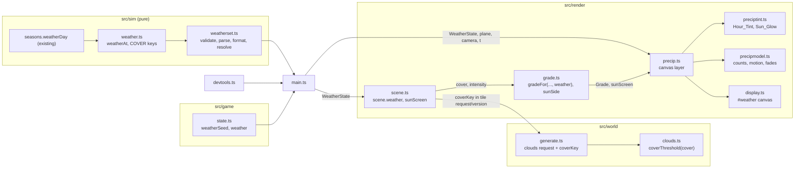
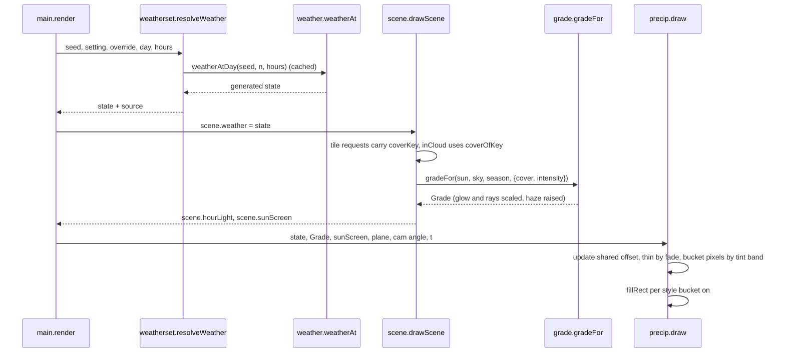

# Design Document

## Overview

The Weather System adds a pure, deterministic `weatherAt(seed, date, hours)` to `src/sim/`. It returns a `WeatherState` (kind, precipitation, intensity, cloud cover, cover bucket). The state is used in exactly two places:

1. **Cloud amount.** The four existing cloud products (low deck, fly-through wisps, high deck, cloud shadows) and the plane's "in cloud" test all read one cover bucket. `cloudLevel` replaces the constant `COVER = 0.7` with a threshold looked up from that bucket. No layer is added. The neutral bucket reproduces today's tiles byte for byte.
2. **Rain and snow.** A new transparent canvas above the HUD and radium-glow canvases draws bitmap streaks and flakes. Their colour is the Grade's light of the hour (sunrise gold, sunset red, dusk blue, night dim), and the sun side of the screen gets the Grade's glow.

Weather never writes to terrain, ground tiles, `SeasonState`, flight, the clock or the save.

I read the code the requirements touch before designing. The findings that shape the design:

| Finding | Where | Consequence |
|---|---|---|
| The Grade already has an on-screen sun direction. `drawGrade` and `drawCloudTint` take `sunScreen`, a unit vector in game-pixel screen space (x right, y down). `drawScene` builds it as `sun.toward` rotated by `-cam.angle`. `gradePixels` maps a pixel to a band position `f = 0.5 + ((x-cx)·dir.x + (y-cy)·dir.y) / (2R)` with `R = hypot(w,h)/2`, and its glow strength follows `f^1.6`. | `render/grade.ts`, `render/scene.ts` | Sun_Side and Sun_Glow reuse that exact mapping. `drawScene` stores the vector as a new `scene.sunScreen` (today only `scene.hourLight` is stored). A small exported `sunSide()` helper in `grade.ts` holds the formula. A test checks it against `gradePixels`. |
| `Grade` carries `near`, `far`, `tintAlpha`, `glow`, `glowAlpha`, `rays`, `night`, `cloud` and `haze`. | `grade.ts` | Hour_Tint is built from `near`, `far`, `tintAlpha` and `night`. Sun_Glow is built from `glow` and `glowAlpha`. No new Grade field is needed. |
| `Sun.horizonMinutes` is game minutes from sunrise (morning) or sunset (evening), and the Grade's own windows use it. | `daylight.ts` | The Sun_Window is `abs(horizonMinutes) <= 45` on either side of the horizon. |
| `weatherDay(n, seed)` is cached (64 entries), already applies the anchors (`force` sets rain 1 and t -1 for 22 Nov 1914), and accepts any integer day number. | `seasons.ts` | Weather reads it as is. Requirement 2.8 holds without extra code. |
| Cloud tiles are requested as `{kind:'clouds'|'cloudShadow', seed, cx, cy}`. `createTileLayer` already accepts `version` and `fadeMs`, keeps drawing a stale tile until the new one arrives, and cross-fades. | `generate.ts`, `tiles.ts`, `scene.ts` | `tiles.ts` needs no change. The scene passes `version` and `fadeMs` to the four cloud layers and adds `coverKey` to their requests. |
| `drawScene` calls `cloudLevel(scene.seed, x, y)` on the main thread for `inCloud`. | `scene.ts` | It must pass the same cover as the tiles (Requirement 5.6). |
| `display.ts` stacks `#hud` and `#hud-glow` over `#game`. `index.html` has `#hud, #hud-glow { pointer-events: none; ... }`. | `display.ts`, `index.html` | The new `#weather` canvas is a third overlay and joins that CSS rule. |
| `perf.ts` fails only when both median and p95 regress by more than 50%. It runs under Node with no canvas. | `perf.ts` | New entries must be pure (state, particle model, cloud tiles). |

### Design decisions that interpret the requirements

Each of these is a place where the requirements cannot be met literally, or leave a free choice. They are listed here so review can reject any of them before implementation.

1. **Precipitation is scheduled per day, cloud is scheduled per 3-hour Weather_Period.** Showers (2.6) are at most 2 hours long, which a 3-hour grain cannot express. So each wet day gets a list of *spells* with start and end times in solar hours, and intensity follows a smooth envelope around each spell. The 3-hour Weather_Period (A3) is the grain of the non-precipitating cloud targets. Targets are blended by smoothstep between period centres, so weather still moves by easing.
2. **`coverKey` is computed from the cover at the start of the current 10-minute game-time cell.** A pure function cannot give "changes at most once in any 10 minutes" (5.12) with a plain bucket of a continuous value, because a cover that turns around near a bucket edge crosses it twice. Sampling the cover on a 10-minute grid makes the bound exact: the key can only change on a grid line. The cost is a lag of at most 10 game minutes between `cloudCover` and the drawn clouds. The rain cover floor is reached 10 minutes before each spell starts, so drawn clouds are never lighter than the bucket the rain needs (decision 3).
3. **Cover buckets are 8 uniform buckets of width 1/8, and the Neutral_Cover is 9/16.** Bucket centres are `(2k+1)/16`, exactly representable in binary. The neutral bucket is key 4, whose centre is 9/16, so it maps to threshold 0.7 with no rounding. The precipitation cover floor is the centre of key 6, 13/16 = 0.8125, which satisfies the "at or above 0.8" rule (5.8, 12.7). Key 6 draws at least 92% of the sample, so rain never falls from a gap-filled sky.
4. **Weather_Kind is derived from the bucket, not the raw cover.** `clear` is key 0 or 1, `overcast` is key 7, `cloudy` is keys 2 to 6, and `rain` or `snow` applies while `intensity > 0.02`. This makes the pixel claims of 5.4 and 5.5 true of what is drawn, even during the 10-minute lag. It also means a `cloudy` sky can be as dense as key 6, which satisfies 2.6 (the sky between showers is "clear or cloudy").
5. **Cross-kind fade is 2.0 s, not 1.0 s.** 6.10 requires at least 2 s whenever rain becomes anything other than rain, and snow is "anything other". 7.7 asks for 1.0 s on rain to snow. Both cannot hold. The design uses 2.0 s for every fade. 7.7's real condition, that combined opacity never jumps, holds because both fades are continuous.
6. **A fade thins particles by a seeded threshold instead of changing alpha.** Alpha stays on the four sprite levels (14.2). Each particle has a fixed hash in [0,1) and is drawn when `hash < opacity`. Opacity falls linearly over 2.0 s, so a frame at 60 Hz removes about 0.8% of particles, and a capped 0.1 s frame removes 5%, both under 25% (6.10).
7. **Particle positions are closed form in (seed, index, shared offset).** Requirements 6.8 and 7.5 say "only from seed, effect time and index". A time-varying streak direction cannot be integrated in closed form from time alone. The design keeps one shared 2-vector `V` (accumulated per frame from direction × speed × dt). Each particle sits at `p0(seed, i) + k(seed, i) · V`, wrapped to the screen. Given the same recorded inputs the frames are identical, and with the game paused `dt = 0` so nothing moves (6.9, 7.6). The determinism test replays a recorded input sequence.
8. **The streak direction lean uses bank, and the heading term comes from the camera lag.** Direction is `d = (-sin θ, cos θ)` with `θ = (plane.heading - cam.angle) + LEAN · bank`. At zero bank and zero camera lag the streaks fall straight down the screen. The sign of `LEAN` is checked against a screenshot during implementation. It cannot be read from the code.
9. **The sky may show glow-reduced light under `cloudy`.** 9.3 says `clear` and `cloudy` leave the Grade unchanged, and 9.4 says any cover above Neutral reduces glow. Keys 5 and 6 are `cloudy` and above Neutral. The numeric rule 9.4 wins: glow is reduced in proportion to the excess cover.
10. **9.13 and 9.14 overlap at sunrise.** The Sun_Window runs 45 minutes either side of sunrise, but the Grade turns blue (`dusk`) within about 12 minutes of the sun crossing the horizon on the dark side. The warm check (9.13) is therefore made on the daylit half of each window (sunrise to +45 minutes, sunset -45 minutes to sunset). The cool check (9.14) is made from 15 minutes beyond the horizon to the end of civil twilight.
11. **Hue shift is measured as a chroma-plane distance for snow.** Near-white snow has almost no chroma, and a gold sky's hue is within 15° of any warm grey. 9.13 asks for at least 15° of hue and a 10% symmetry between sunrise and sunset. The design checks a chroma-plane distance (opponent channels `a = R - G`, `b = (R + G)/2 - B`) of at least 0.08 of full range for both kinds. It additionally asserts the 15° hue rule for rain, whose midday hue is about 205° and so is at least 100° from every warm palette colour. Sunrise and sunset shifts are compared for the same Sky; the dawn path blends 30% toward the palette glow (`gradeFor`), so the symmetry test tolerance is set from a measured run (expected near 10% to 15%) and reported if it exceeds 10%.
12. **`weatherDay` is read with the Weather_Seed, not the world seed.** With the default (`weatherSeed` = world seed) the sky agrees with the ground exactly (A1). When a developer sets a different weather seed, the sky is deliberately decoupled from the lying snow, which is what 13.10 asks for.
13. **8.5's contrast floor is a measured check.** With every particle alpha at most 0.6, a pair of adjacent covered pixels keeps at least 40% of its contrast exactly. For a covered pixel next to an uncovered one, the floor holds whenever the particle colour lies inside the luminance range of the pair. The design therefore caps alpha over the instrument board at 0.3 and checks the 40% floor on the HUD needle and face fixtures.

## Architecture



`main.ts` computes one `WeatherState` per frame, before the scene draws: `resolveWeather(...)` picks the source (override, then game setting, then generated). It hands the state to the scene (`scene.weather`) and to the precipitation layer. The renderer only reads the state.

### Per-frame data flow



### Module layout

| Module | Responsibility | New or changed |
|---|---|---|
| `src/sim/weather.ts` | Types, bucket constants, `weatherAt`, `weatherAtDay`, day schedules, caches. Imports only `calendar`, `climate`, `seasons` (read-only: `weatherDay`) and `core/noise`. | new |
| `src/sim/weatherset.ts` | `WeatherSetting`, `WeatherOverride`, validators, `parseWeatherOverrides`, `formatWeatherSetting`, `applyWeather`, `resolveWeather`. | new |
| `src/world/clouds.ts` | `cloudLevel(seed, x, y, cover = NEUTRAL_COVER)`, `coverThreshold`, `cloudChunk` and `cloudShadowChunk` take a cover. | changed |
| `src/world/generate.ts` | `TileRequest` clouds variant gains `coverKey?: number`; the worker turns it into a cover. | changed |
| `src/render/grade.ts` | `gradeFor(sun, sky, season, weather?)`, `sunSide()`, `RAIN_COLOUR`, `SNOW_COLOUR`. | changed |
| `src/render/preciptint.ts` | Pure Hour_Tint and Sun_Glow: `particleColour(grade, kind, f)`. | new |
| `src/render/precipmodel.ts` | Pure particle model: counts, lengths, speeds, direction easing, offsets, fades, droplets, pixel lists. | new |
| `src/render/precip.ts` | The canvas layer: style cache, bucketed `fillRect`, visibility, reduced motion. | new |
| `src/render/display.ts` | Creates `#weather` (null when unavailable), sizes it with the others. | changed |
| `src/render/scene.ts` | `scene.weather`, `scene.sunScreen`, `coverKey` in cloud requests, versions and fades, `inCloud` cover, Grade weather argument. | changed |
| `src/game/state.ts` | `weatherSeed` and `weather` fields, validation, `beginSortie` and `restoreGame`. | changed |
| `src/main.ts`, `src/devtools.ts`, `src/perf.ts`, `index.html` | Wiring, console API, benchmarks, CSS. | changed |
| `docs/MECHANICS.md`, `docs/HISTORICAL_RESEARCH.md`, `docs/TECH.md`, `docs/AGENT_TOOLS.md`, `.kiro/specs/seasons-system/*` | Documentation (Requirement 15.7 to 15.9). | changed |

`src/render/tiles.ts`, `src/game/save.ts`, `src/sim/seasons.ts`, `src/sim/flight.ts` and every ground module are **not** changed. A source-level test enforces it (see Testing Strategy).

## Components and Interfaces

### `src/sim/weather.ts`

```ts
export type WeatherKind = 'clear' | 'cloudy' | 'overcast' | 'rain' | 'snow';
export type Precipitation = 'none' | 'rain' | 'snow';
export type WeatherState = {
  kind: WeatherKind;
  precipitation: Precipitation;
  intensity: number;  // 0..1, continuous
  cloudCover: number; // 0..1, continuous
  coverKey: number;   // integer 0..7: bucket of the cover at the start of the current 10-minute cell
};
export const COVER_KEYS = 8;
export const NEUTRAL_KEY = 4;
export const NEUTRAL_COVER = 9 / 16;
export const coverOfKey = (k: number) => (2 * k + 1) / 16;
export const keyOfCover = (c: number) => Math.min(COVER_KEYS - 1, Math.max(0, Math.floor(c * COVER_KEYS)));
/** Throws RangeError naming the argument for a date outside 1900-01-01..2100-12-31 or hours not in [0, 24). */
export function weatherAt(seed: number, date: CalDate, hours: number): WeatherState;
export function weatherAtDay(seed: number, dayNumber: number, hours: number): WeatherState;
export function clearWeatherCache(): void; // tests only
```

**Day schedule** (cached by `(seed, day)`, 16 entries, same `memo` shape as `seasons.ts`). For day `n`, let `w = weatherDay(n, seed)`.

- No spells when `w.rain === 0`.
- `peak = min(1, 0.15 + 0.85 · w.rain^0.6)`. This is strictly increasing in `w.rain`, so 2.10 holds across all months.
- `snow = w.t < 1.5`, else rain (A1, the threshold `stepGround` uses). One type per day.
- **Steady months (October to February):** one spell of length `L = 3.2 + 5.8·u` hours, `u = hash(seed+610, n, 0)`, starting at `0.25 + (23.5 - L)·hash(seed+611, n, 0)` hours. Ramp `R = 60` minutes.
- **Showery months (March to September):** one to three spells, one per chosen 4-hour slot of the 20 hours between 02:00 and 22:00. Count is `1 + (hash(seed+612,n,0) < 0.5) + (hash(seed+612,n,1) < 0.25)`. Slots are picked by sorting `hash(seed+613, n, i)`. In slot `i`, `L = 1.75 + 0.2·hash(seed+614,n,i)` hours and the start offset inside the slot is `0.55 + (4 - L - 1.1)·hash(seed+615,n,i)`. Ramp `R = 52` minutes. Two spells in adjacent slots are therefore at least 1.1 hours apart, and none is longer than 1.95 hours (2.6).

Spells lie inside `[0, 24]` hours of their own day, so the envelope is 0 at both day boundaries and the kind never changes while precipitating.

**Intensity.** For each spell `(s, e, R)` in minutes, `I(t) = peak · smoothstep((t-s)/R) · smoothstep((e-t)/R)`. The state takes the maximum over the day's spells. The slope is at most `1.5 · peak / R`, which is 0.0288 per minute for showers and 0.025 for steady rain, under the 0.03 limit (3.3). A prototype scan of two simulated years with three seeds, using a 50-minute shower ramp, measured exactly 0.0300 (the bound for peak 1), which is why the shower ramp is 52 minutes. The implementation test repeats the scan.

**Cloud cover.** `cloudCover = max(base(t), 0.8125 · S(t))`.

- `base(t)`: each global period `g = n·8 + floor(hours/3)` has a target `b_g = clamp(m(doy) + 0.28·(valueNoise(seed+601, g/6, 0)·2 - 1) + 0.1·(hash(seed+602, g, 0)·2 - 1), 0.05, 0.95)`. `m(doy) = dailyValue(MEAN, doy)` where `MEAN` is `[0.72, 0.68, 0.62, 0.56, 0.52, 0.50, 0.48, 0.48, 0.52, 0.60, 0.70, 0.74]` (January to December; **[VERIFY]** against northern-France sunshine normals). Between period centres, `base` is a smoothstep interpolation of the two neighbouring targets. The largest slope is `1.5 · 0.9 / 180 = 0.0075` per minute. Targets are cached by `(seed, g)` (32 entries).
- `S(t)` is the cloud-up envelope: for each spell of the previous, current and next day (shifted by whole days), `smoothstep((t - (s - 10 - 105))/105) · smoothstep((e + 105 - t)/105)`, maximised over spells. `S = 1` from 10 minutes before the spell starts to the moment it ends. The largest slope of `0.8125·S` is `1.5 · 0.8125 / 105 = 0.0116` per minute (under 0.02). The maximum of functions with bounded slope has the same bound. The prototype measured 0.01161.

**Key.** `coverKey = keyOfCover(cloudCoverAt(floor(hours·6)/6))`, the cover at the start of the current 10-minute cell. Within one cell the key is constant, and between cells it changes at most once, so at most once per 10 minutes. While `intensity > 0` the cover has been at or above 0.8125 since 10 minutes before the spell, so the key is always 6 or 7 under precipitation.

**Kind.** `rain` or `snow` when `intensity > 0.02`, otherwise `clear` (key 0 or 1), `overcast` (key 7), `cloudy` (keys 2 to 6). `precipitation` is the day's type whenever `intensity > 0`, else `none`.

**Cost.** One call reads three cached day schedules, two cached period targets, and a handful of `smoothstep` and `hash` calls. The cell-start cover is cached per `(seed, day, cell)` (one entry). The renderer calls it once per frame.

### `src/sim/weatherset.ts`

```ts
export type WeatherSetting = { kind: WeatherKind; intensity?: number; cloudCover?: number };
export type WeatherOverride = { kind?: WeatherKind; intensity?: number; cloud?: number; seed?: number };
export type WeatherSource = 'generated' | 'game state' | 'override';
export const DEFAULTS = { rain: 0.6, snow: 0.5, clear: 3 / 16, cloudy: 11 / 16, overcast: 15 / 16, wet: 13 / 16 };
export function readWeatherSetting(v: unknown): WeatherSetting;   // throws Error('Invalid weather setting: <field>.')
export function readWeatherSeed(v: unknown): number;              // integer 0..2^31-1
export function parseWeatherOverrides(search: string): { overrides: WeatherOverride; problems: string[] };
export function formatWeatherSetting(s: WeatherSetting): string;  // 'weather=rain&precip=0.6&cloud=0.9'
export function applyWeather(base: WeatherState, set: Partial<WeatherSetting> & { cloud?: number }): WeatherState;
export function resolveWeather(a: { worldSeed: number; weatherSeed: number | null; setting: WeatherSetting | null; override: WeatherOverride | null; day: number; hours: number }):
  { state: WeatherState; source: WeatherSource; seed: number };
```

`resolveWeather` computes `seed = override.seed ?? weatherSeed ?? worldSeed`, takes the generated state, then applies the game setting, then the override. Each layer replaces only the fields it names, so the precedence is override, then setting, then generated (13.4). `source` is the highest layer that applied anything.

`applyWeather` rules:

- `kind` is `rain` or `snow`: `precipitation = kind`, `intensity = set.intensity ?? 0.6 / 0.5`, `cloudCover = set.cloudCover ?? max(base.cloudCover, 0.8125)`.
- `kind` is `clear`, `cloudy`, `overcast`: no precipitation, `intensity = 0`, `cloudCover = set.cloudCover ?? 3/16, 11/16, 15/16`.
- No kind, `intensity` given: `intensity > 0` makes `precipitation` the generated type, or `rain` when there is none, with `cloudCover = max(base, 0.8125)` unless cloud is given. `intensity = 0` removes precipitation.
- No kind, only `cloud`: replace the cover.
- `coverKey = keyOfCover(cloudCover)` for any forced state (no 10-minute lag; the forced weather is static), and `kind` is re-derived unless it was forced. A forced `?cloud=` with `?weather=rain` is honoured as given (12.8).

`parseWeatherOverrides` mirrors `parseOverrides` in `seasons.ts` (same number regex, same `problems` strings). It accepts `weather`, `precip`, `cloud` (decimal 0 to 1) and `weatherSeed` (integer 0 to 2^31-1). It drops each bad value and adds one `name=value: reason` entry per drop (12.4).

`readWeatherSetting` accepts only the five kinds, and `intensity` and `cloudCover` finite in [0,1]. It rejects anything else with `Invalid weather setting: kind.` and so on, in the style of `readWorld` (13.5).

### Clouds and the tile pipeline

`src/world/clouds.ts`:

```ts
const THRESHOLDS = [0.995, 0.98, 0.88, 0.80, 0.70, 0.45, 0.0, -0.12]; // value of COVER at each bucket centre
export function coverThreshold(cover: number): number { /* linear between centres; exact at centres */ }
export function cloudLevel(seed, x, y, cover = NEUTRAL_COVER): number { return cloudLevelAt(seed, x, y, coverThreshold(cover)); }
export function cloudChunk(seed, cx, cy, cover = NEUTRAL_COVER)        // threshold computed once per tile
export function cloudShadowChunk(seed, cx, cy, cover = NEUTRAL_COVER)
```

The body of `cloudLevel` is unchanged except `density = (c - T) / (1 - T)` with `T` in place of `COVER`. `T = 0.7` is the value at key 4, so at `NEUTRAL_COVER` the arithmetic is the same operations on the same numbers and tiles are byte-identical. `coverThreshold` computes `f = cover·8 - 0.5`, indexes the table with `Math.floor(f)`, and interpolates on the fraction. At a bucket centre `f` is an exact integer (centres are `(2k+1)/16`), the fraction is 0, and the table value is returned unchanged. Thresholds must stay below 1 because `1 - T` is a divisor.

**Calibration.** I measured the share of drawn pixels (level at least 0) on a 256 by 256 lattice at stride 16 (65,536 samples) for 16 seeds. The table above gives:

| Key | Cover centre | Threshold | Drawn share (range over 16 seeds) | Role |
|---|---|---|---|---|
| 0 | 1/16 | 0.995 | 2.6% to 4.6% | clear |
| 1 | 3/16 | 0.98 | 3.5% to 6.4% (15% to 21% of Neutral) | clear default |
| 2 | 5/16 | 0.88 | 9% to 15% | cloudy |
| 3 | 7/16 | 0.80 | 14% to 22% | cloudy |
| 4 | 9/16 | 0.70 | 23% to 34% | Neutral (today) |
| 5 | 11/16 | 0.45 | 49% to 64% | cloudy default |
| 6 | 13/16 | 0.0 | 92% to 97% | precipitation floor |
| 7 | 15/16 | -0.12 | 100% | overcast default |

Keys 0 and 1 stay at or below 25% of the Neutral share (largest measured ratio 0.21, 5.4). Keys 6 and 7 cover at least 85% (smallest measured 92.2%, 5.5). Share is non-decreasing in key, and the check also tests it between buckets (5.3). A calibration test fixes the 16 seeds and fails if any claim breaks, so changing the table is safe.

**Tile plumbing** (`generate.ts`, `scene.ts`):

- `TileRequest` clouds variant: `{ kind: 'clouds' | 'cloudShadow'; seed; cx; cy; coverKey?: number }`. `generateTile` calls `cloudChunk(seed, cx, cy, coverOfKey(req.coverKey ?? NEUTRAL_KEY))`. An absent key is Neutral, so old callers and the fingerprint tool are unchanged.
- In `createScene`, the four cloud layers become:

```ts
const coverVersion = () => String(scene.weather.coverKey);
clouds:       createTileLayer((cx, cy) => gen({ kind: 'clouds',      seed,      cx, cy, coverKey: scene.weather.coverKey }), CHUNK, { version: coverVersion, fadeMs: COVER_FADE_MS }),
cloudShadows: createTileLayer((cx, cy) => gen({ kind: 'cloudShadow', seed,      cx, cy, coverKey: scene.weather.coverKey }), CHUNK, { version: coverVersion, fadeMs: COVER_FADE_MS }),
wisps:        ...seed + 5 ..., highClouds: ...seed + 13 ...  // same version and fade, existing prefetch options kept
```

`createTileLayer.fetch` reads `version(cx, cy)` and then calls `request(cx, cy)` synchronously, so both read the same `scene.weather.coverKey`. A tile that arrives for an older key is marked stale and re-requested by the existing `get()` logic. While the new tile is made, the old one keeps drawing (11.12, 11.13). When it lands, the layer cross-fades for `COVER_FADE_MS = 3000` (5.10). Ground and sunlight layers do not read `scene.weather` (4.2, 4.8). `scene.weather` starts as `{kind:'cloudy', precipitation:'none', intensity:0, cloudCover:NEUTRAL_COVER, coverKey:NEUTRAL_KEY}` so a scene made before the first frame behaves as today.

- `drawScene`'s `inCloud` becomes `cloudLevel(scene.seed, x, y, coverOfKey(scene.weather.coverKey))`. Every cloud product and the in-cloud test use the same bucket in the same frame (5.6).
- The key changes only on a 10-game-minute grid line (decision 2), so tile regeneration is bounded: all four layers regenerate their visible tiles at most once per 10 game minutes, which is about 7 real seconds at 1x clock and about 2 s at the fast-time default in development.
- Landing page (`drawTerrain`): `main.ts` sets `scene.weather` from the day's generated state with `precipitation: 'none'` and `intensity: 0` before the call, so the landing clouds are the flight's clouds (A6).
- 9.9 (no crisp shadows under cover) needs no new code. At keys 6 and 7 the cloud shadow tile covers at least 92% of pixels, and the existing `destination-out` pass already removes tree shadows, glints and the plane's shadow wherever a cloud shadow falls.

### `src/render/grade.ts` changes

```ts
export type GradeWeather = { cover: number; intensity: number };
export function gradeFor(sun: Sun, sky: Sky, season?: { skyBias: number; haze: number }, weather?: GradeWeather): Grade;
export function sunSide(dx: number, dy: number, dir: { x: number; y: number }, R: number): number; // f in [0,1]
export const RAIN_COLOUR: RGB = hex(0xa4b0bd);  // pale grey-blue; next to HAZE_COLOUR
export const SNOW_COLOUR: RGB = hex(0xe0ded9);  // near-white warm grey
```

When `weather` is omitted the result is identical to today (9.3, 15.6). With it:

- `exc = clamp01((cover - 9/16) / (1 - 9/16))`; `wet = clamp01(exc + intensity)`; `scale = 1 - 0.75·wet` (so at least 0.25). `glowAlpha *= scale` and `rays *= scale` (9.4). `near`, `far`, `tintAlpha`, `night` and `cloud` are untouched, so night grade is unchanged (9.8) and the Hour_Tint is unaffected (9.17).
- `haze = clamp(season.haze + 0.35·intensity, 0, 0.6)` (9.5). The existing veil pass draws it; no new pass.
- `active` is recomputed with the same formula.

`sunSide(dx, dy, dir, R)` returns `clamp01(0.5 + (dx·dir.x + dy·dir.y) / (2R))`, the band position `gradePixels` uses (`dx = x - w/2`, `dy = y - h/2`). Sun_Glow weight is `sunSide(...)^1.6`, the same law as `glowPack`. A unit test compares the helper with the band picked by `gradePixels` for random pixels.

### Precipitation layer

**`render/precipmodel.ts` (pure).** All numbers are in game pixels and seconds.

| Quantity | Rule |
|---|---|
| Rain streak count | `n = round(20 + 340·((i - 0.02)/0.98))`, 20 at 0.02, 360 at 1. Zero at or below 0.02. |
| Rain streak length | `len = round(2 + 10·i)`, from 2 to 12 (6.1, 6.5). |
| Rain speed | `v = 260 + 260·i` px/s, 260 to 520. Each streak scales it by `0.85 + 0.3·hash(seed+701, idx, 0)`. |
| Lens droplets | While `i > 0.4`: up to 12 slots, spawn rate `4·(i-0.4)/0.6` per second overall, 1 to 3 px, speed 25 to 60 px/s down the screen, life 2.4 to 3.0 s, fade to nothing across the life. At `i <= 0.4`, no new spawns; live ones finish (6.6, 6.7). |
| Snow flake count | `n = round(400·(i - 0.02)/0.98)`, 0 at or below 0.02 (7.3, 7.8). |
| Snow flake size and speed | Size 1, 2 or 3 px by `hash`. Fall speed is the rain speed at the same `i` times `0.1 + 0.4·hash(seed+702, idx, 0)` (10% to 50%). Side drift `±(6 + 12·hash)` px using `valueNoise(seed+703+idx, t/(2 + 3·hash), 0)` (7.2). |
| Large flakes | While `i > 0.5`: `3 + floor(7·(i - 0.5)/0.5)` of them (3 to 10), an 8 by 8 dithered disc, moving 1.6 to 2.4 times the flake speed (parallax). Never scaled (7.4). |
| Direction | `θ = (heading - camAngle) + 0.30·bank`. `θ` eases toward its target with time constant 0.15 s and a slew limit of 90°/s. With `dt <= 0.1 s` a frame turns at most 9°, under 15° (6.3, 6.4). Streak step is `d = (-sin θ, cos θ)`. |
| Shared offset | `V += d·v_base·dt`, wrapped modulo the screen plus a 16 px margin. Particle `i` is at `(x0_i + k_i·V.x, y0_i + k_i·V.y)` wrapped, `x0 = hash(seed+704, i, 0)·W`, `y0 = hash(seed+705, i, 0)·H`, `k_i` in `[0.85, 1.15]`. |
| Effect time | `dt = clamp(t - lastT, 0, 0.1)` where `t = state.elapsedSeconds`. Paused, `t` does not advance, `dt = 0` (6.9, 7.6). Clock speed does not enter. |
| Area budget | `count = min(count, floor(0.12·W·H / 12))` for streaks, `/ 9` for flakes, `/ 64` for large flakes, so coverage stays under 12% on any screen (8.3). |
| Cap | Total drawn at most 600: 360 + 12 for rain; 400 + 10 for snow (11.5). |
| Reduced motion | Counts × 0.5 and speeds × 0.5 (8.10). |
| Fade | One opacity per kind, moved by `dt/2.0` toward 1 (the active kind) or 0. Particle `i` draws when `hash(seed+706, i, 0) < opacity`. Rain to snow fades both over the same 2.0 s, so the sum of their opacities is continuous (6.10, 7.7). |
| Clamp | `intensity` is clamped to [0,1], and non-finite becomes 0, before any use (6.11). |

The model outputs, per frame, flat typed arrays of `(x, y, styleIndex)` for the pixels to fill. The arrays are allocated once at start-up, sized for 600 particles times 12 pixels plus the droplet and large-flake discs, so no per-frame allocation happens (11.4).

**Alpha levels (14.2).** Four sprite alpha levels: `0.15, 0.28, 0.40, 0.50`. A streak runs head to tail with a taper `a = 1 - k/len`, and the level of pixel `k` is `floor(a·4 + bayer(x, y) - 0.5)` clamped to 0..3, so the tail breaks up with the same 4 by 4 Bayer pattern as clouds. Snow uses 0.50 (1 px), 0.40 (2 px), 0.28 (3 px). Large flakes and droplets use 0.15 and 0.28 with a dithered edge.

**`render/preciptint.ts` (pure): Hour_Tint and Sun_Glow.** The layer asks for one colour per (kind, sun-side band, alpha level). The function is `particleColour(g: Grade, kind: 'rain' | 'snow', f: number): RGB`:

1. **Hour_Tint.** `c = mix(g.far, g.near, f)` is the world's own multiply tint on that side of the screen. `a = clamp01(g.tintAlpha / 0.15)`: 0 in plain daylight, 1 early in the golden hour, so the outer part of a winter Sun_Window (where the Grade's tint is already weak) still reads warm. `lit = Y(base) + 1.5·(c - Y(c))·s`: the tint's own chroma, times 1.5, moved to the base colour's luminance. Shifting all channels equally keeps the hue; `s <= 1` scales the chroma down so no channel leaves 0..255 (clipping would bend the hue). Absolute chroma, not a hue normalised to full brightness, so a dark dusk tint does not amplify its per-frame change (9.19). `rgb = mix(base, lit, a)`. Then `rgb *= 1 - 0.35·g.night`, so night particles stay at least 0.25 of the range above the dark world (9.7). `base` is `RAIN_COLOUR` or `SNOW_COLOUR`.
2. **Sun_Glow.** `gs = clamp01(g.glowAlpha / 0.68)` (0.68 is the largest `glowAlpha` the Grade produces: `0.85·0.8`), not gated on `rays` (rays reach 0 at a higher sun than `glowAlpha`, so a gate would step the glow in). `w = f^1.6`. `rgb = rgb·(1 - 0.10·gs·(1 - w))` darkens the far side. Then the Grade's own glow colour is screened over the sun side with weight `0.5·gs·w`: `rgb = 255 - (255 - rgb)·(1 - 0.5·gs·w·glow/255)`. A screen only brightens, even when the glow near the horizon is a deep red darker than the particle (a plain mix would darken the sun side). The glow changes colour only, never alpha, so alpha stays on the four levels and under 0.6 (9.16).
3. `f` is quantised into 5 bands: `band = min(4, floor(f·5))`, and the band's mid value is used. Each band has its own colour per kind.

Properties of this construction, each with its own check:

- *Everywhere, every hour* (9.12): the colour is a function of the Grade, so no particle ignores it, in the Sun_Window, in twilight and at night.
- *Warm half-window* (9.13): near the horizon `near` is gold or red and `a = 1`. The mean particle colour moves at least 0.08 of range in the chroma plane from its midday value (decision 11), and for rain by at least 15° of hue.
- *Twilight* (9.14): after `dusk` the multiply tint is blue (`DUSK_BLUE`, then `NIGHT_BLUE`). The mean hue of the rain colour moves toward 240° by at least 15° (from about 205° to 227° to 238°).
- *Cover independence* (9.17): `near`, `far`, `tintAlpha`, `night` do not depend on `weather`. The hue shifts at `cloudCover` 1 equal those at Neutral. Only `g.glowAlpha` carries the 9.4 reduction, so Sun_Glow scales down to 25% and never below.
- *Continuity* (9.10, 9.18, 9.19, 9.20): every input is a continuous function of the sun elevation. `gs` is 0 outside `rayWindow`, so the glow starts and ends without a step. The outgoing and incoming particles of a fade use the same function at the same time, so there is no colour jump.
- *Sun-side luminance difference* (9.15): over every palette the half-screen mean luminance difference divided by `gs` measures 5.3% to 9.4% of range (sun side higher; lowest for the deep-red Blood Orange glow on snow). The test checks `difference / gs` lies in [0.05, 0.25] for `gs >= 0.3`.
- *Unavailable inputs* (9.11, 9.22): the layer keeps the last Grade and `sunScreen` it received. With no previous Grade it draws with the base colours and no glow.

**`render/precip.ts` (the canvas layer).**

```ts
export type PrecipLayer = {
  draw(frame: PrecipFrame): void;   // never throws; failures are caught by the caller (10.7)
  hide(): void;                     // landing, desk, loading: clears once, sets hidden, then 0 draw calls
};
export type PrecipFrame = {
  ctx: CanvasRenderingContext2D | null; view: View; weather: WeatherState; seed: number;
  grade: Grade | undefined; sunScreen: { x: number; y: number } | undefined;
  heading: number; bank: number; camAngle: number; t: number; boardRects?: readonly Rect[];
};
export function createPrecipLayer(reducedMotion: boolean): PrecipLayer;
```

Per frame it updates the model, then builds, for each of the 5 sun-side bands and 4 alpha levels, a list of pixels (counting sort into preallocated `Int16Array`s). It sets `fillStyle` once per non-empty bucket and calls `fillRect(x, y, 1, 1)` (or `size` for snow) at whole game-pixel coordinates under `setTransform(scale, 0, 0, scale, 0, 0)` with smoothing off. Style strings are rebuilt only when the quantised tint key (each channel in steps of 4/255) changes. That is the Grade layer's own repaint rule, and it is the one place a steady frame can allocate.

- Cost: at most about 4,300 `fillRect` calls at the highest rain intensity (360 streaks of up to 12 pixels), plus about 60 for droplets. Snow is at most about 410 flakes plus 10 discs of about 40 rows. The 1.5 ms budget (11.6) is measured with `archie.stats()` (see Testing Strategy).
- Over the instrument board (`boardRects` from `drawHud`), alpha is multiplied by 0.5, so it never exceeds 0.25 there (decision 13).
- With `precipitation` `none` and all fades at 0, `draw` returns before touching the context, and the canvas is hidden (11.3). The one `clearRect` happens on the frame the last fade reaches 0.
- A null context (canvas or 2D context unavailable) makes `draw` a no-op (8.12).
- `aria-hidden="true"`, no tab stop, and `pointer-events: none` via the CSS rule (8.1, 8.9).

**`render/display.ts`.** `createDisplay` makes `#weather` after `#hud-glow` in a `try`/`catch`; on failure `precip` is `null`. It is sized in `resize()` with the other three and has `imageSmoothingEnabled = false`. `Display` gains `precip: CanvasRenderingContext2D | null`. `index.html` changes its CSS rule to `#hud, #hud-glow, #weather { ... pointer-events: none; }`.

### `src/game/state.ts`

`Data` gains `weatherSeed: number | null` and `weather: WeatherSetting | null`. The version stays 2.

- `createGame` accepts `weatherSeed` and `weather` options, validated by `readWeatherSeed` and `readWeatherSetting`.
- `SortieSetup` gains `weatherSeed?: number | null` and `weather?: WeatherSetting | null`. `undefined` keeps the current value, `null` clears it. They are validated with the other fields before any mutation, so a failure leaves the game unchanged (13.5).
- `restoreGame` reads `s.weatherSeed ?? null` and `s.weather ?? null`. A missing field is accepted (13.6). A present field is validated.
- `snapshot()` is `structuredClone(data)`, so both fields are included (13.7).
- The effective weather seed is `data.weatherSeed ?? data.seed`. It follows a changed world seed when no weather seed is set. A small exported `weatherSeedOf(state)` holds that rule.
- `game/save.ts` is not touched (13.8).

### `src/main.ts`, `src/devtools.ts`

- `main.ts` holds `weatherOverride: WeatherOverride`, parsed with `parseWeatherOverrides` only when `IS_DEV` or `?debug` (12.11), with one `console.warn` per problem (12.5). Each frame, before the scene is drawn:

```ts
const w = resolveWeather({ worldSeed: state.seed, weatherSeed: state.weatherSeed, setting: state.weather,
  override: weatherOverride, day: dayNumber(dateOf(state.clock.day)), hours: state.clock.hours });
scene.weather = w.state;
```

  If `resolveWeather` throws (a campaign day beyond 2100, for example), the previous state stays, one warning is logged, and the frame continues (3.7, 10.7).
- After `drawScene`, `main.ts` writes the glow into the HUD pass as today, then calls `precip.draw({...})` inside `try`/`catch` with `scene.hourLight`, `scene.sunScreen`, `plane`, `cam.angle` and `state.elapsedSeconds - STEP·(1 - alpha)`. The call is marked as a new profiler stage `weather`. On the landing, desk and loading branches it calls `precip.hide()`.
- `DevHooks` gains `weather(): { state: WeatherState; overrides: WeatherOverride; source: WeatherSource; seed: number }` and `setWeatherOverride(o: WeatherOverride)`.
- `installDevApi` adds `archie.weather(kind?, intensity?)` (no argument returns the state, overrides and source; `null` clears all), `archie.cloud(value?)` and `archie.weatherSeed(n?)`. A bad argument is ignored with one `console.warn` naming the argument and value, and the earlier valid override stays (12.5). `archie.state()` gains `weather`, `weatherSeed` and `weatherOverridden`. `snapshot()` and `photo()` include `display.precip.canvas` in `canvases`. `HELP` and the `URL:` line list `?weather= ?precip= ?cloud= ?weatherSeed=` and each new call (12.13).
- The debug panel gains one line: `weather   rain 0.60  cover 0.81  key 6  (override)`.
- `hideForPhoto` includes the new canvas.

## Data Models

```ts
// sim/weather.ts
type Spell = { s: number; e: number; R: number };           // minutes in the day; R = ramp minutes
type DaySchedule = { peak: number; snow: boolean; spells: Spell[] };
// caches: schedules (16, key = day·2^32 + seed), period targets (32), cell cover (1)

// sim/weatherset.ts
type WeatherSetting  = { kind: WeatherKind; intensity?: number; cloudCover?: number };
type WeatherOverride = { kind?: WeatherKind; intensity?: number; cloud?: number; seed?: number };

// game/state.ts (Data additions)
weatherSeed: number | null;     // null = follow the world seed
weather: WeatherSetting | null; // null = generated weather

// render/scene.ts (Scene additions)
weather: WeatherState;                       // read by cloud layers, in-cloud test, Grade
sunScreen: { x: number; y: number };         // unit vector toward the sun on screen, set each drawScene

// render/precipmodel.ts
type PrecipModel = {
  seed: number; theta: number; V: { x: number; y: number }; lastT: number;
  opacity: { rain: number; snow: number };
  droplets: Float32Array;   // 12 slots × (x, y, born, size)
  px: Int16Array; py: Int16Array; style: Uint8Array; n: number; // pixel lists, allocated once
};
```

Nothing here is persisted except the two optional game-state fields, and those are session data, not the browser save.

### Tuning values fixed in this design

| Requirement | Value fixed here |
|---|---|
| A3 Weather_Period | 3 solar hours; used for non-precipitating cloud targets (decision 1) |
| 2.3 monthly share tolerance | 0.08 absolute (as written); a prototype over 30 years (1920 to 1949) was within 0.04 in every month |
| 2.6 shower spell and gap | spell 1.75 to 1.95 h, gap at least 1.1 h, March to September |
| 2.7 steady spell | 3.2 to 9.0 h, October to February |
| 3.3 rate limits | intensity at most 0.0288 per game minute (shower), 0.025 (steady); cover at most 0.0116 per game minute |
| 5.8, 12.7 precipitation cover floor | 13/16 = 0.8125 |
| 5.11 buckets | 8 |
| 6.5 streak count, length, speed | 20 to 360 streaks; 2 to 12 px; 260 to 520 px/s |
| 6.6 droplet life | 2.4 to 3.0 s, at most 12, only above intensity 0.4 |
| 8.3 pixel coverage | 12% of screen pixels, enforced by the area budget |
| 8.4 alpha cap | 0.6 overall; sprite levels at most 0.50; 0.25 over the instrument board |
| 9.4 glow floor | 25% of strength (`scale = 1 - 0.75·wet`) |
| 9.7 night separation | particle luminance at least 25% of range above the world |
| 9.10, 9.19 colour step | at most 5% of range per frame |
| 9.13, 9.14 hue | at least 15° for rain; chroma-plane distance at least 0.08 for both kinds; symmetry tolerance set from measurement (decision 11) |
| 11.5 particle cap | 600 drawn per frame (actual maximum 412) |
| 11.6, 11.7 frame cost | at most 1.5 ms at maximum rain or snow; at most 0.05 ms with no precipitation |
| 12.6 default intensities | rain 0.6, snow 0.5 |
| Fade duration | 2.0 s (decision 5) |
| Cloud cross-fade | 3000 ms |
| Key sampling cell | 10 game minutes |

## Correctness Properties

*A property is a characteristic or behavior that should hold true across all valid executions of a system-essentially, a formal statement about what the system should do. Properties serve as the bridge between human-readable specifications and machine-verifiable correctness guarantees.*

Properties 1 to 20 cover the pure simulation, the cloud buckets and the settings. Properties 21 to 30 cover the pure particle and colour model. The canvas drawing, the CSS, the worker wiring and the frame-time budgets are covered by example tests and measurements (see Testing Strategy).

### Property 1: Weather_State is a pure function of seed, date and time

*For any* Weather_Seed, Calendar_Date in 1900 to 2100 and Solar_Time in [0, 24), calling `weatherAt` twice returns deeply equal states, including when other calls happen between them, after `clearWeatherCache()`, and when the same day number and hour are reached by different routes (running, `archie.time()`, a restored state, any clock speed).

**Validates: Requirements 1.1, 1.2, 1.3, 3.5, 3.6, 13.9**

### Property 2: Every state field is finite and in range

*For any* Weather_Seed, any day from 1 January 1900 to 31 December 2100 (leap days and year boundaries weighted in) and any hour in [0, 24), `intensity` and `cloudCover` are finite and in [0, 1], `coverKey` is an integer in [0, 7], `precipitation` and `kind` come from their sets, `kind` is `rain` or `snow` only when `precipitation` has the same name, and `intensity > 0` implies `precipitation` is not `none`.

**Validates: Requirements 1.5, 3.1, 5.11**

### Property 3: Invalid input is rejected by name

*For any* date outside the range or not in the calendar, and any hours value that is negative, 24 or more, NaN or infinite, `weatherAt` throws a `RangeError` whose message names the invalid argument (`date` or `hours`) and returns no state.

**Validates: Requirements 1.8, 3.7**

### Property 4: Different seeds give different weather

*For any* two distinct Weather_Seeds, the state sequences sampled at one fixed hour over 365 consecutive days differ on at least one day.

**Validates: Requirements 1.6**

### Property 5: Precipitation follows the Daily_Model

*For any* Weather_Seed and day, the state has `intensity > 0` at some minute of that day if and only if `weatherDay(n, seed).rain > 0`. On such a day every precipitating state has `precipitation = 'snow'` when `weatherDay(n, seed).t < 1.5` and `'rain'` otherwise, and `intensity` is 0 at 00:00 and at 24:00 so the type never changes while falling.

**Validates: Requirements 2.1, 2.2, 2.11**

### Property 6: No snow from 1 May to 30 September

*For any* Weather_Seed, any day from 1 May to 30 September of any year in range, and any hour, `precipitation` is never `'snow'`.

**Validates: Requirements 2.4**

### Property 7: Seasonal frequencies follow the climate

*For any* Weather_Seed in a fixed sample, over at least 20 simulated years outside the anchor years, the share of wet days in each month is within 0.08 of `wetDays[month] / daysInMonth`; the share of snow among wet days is higher in each of December, January and February than in each of October, November, March and April; and the mean non-precipitating `cloudCover` over November to February exceeds the mean over June to August.

**Validates: Requirements 2.3, 2.5, 2.9**

### Property 8: Showers are short and separated

*For any* Weather_Seed and any wet day from March to September, each spell lasts at most 2 solar hours, consecutive spells are at least 1 solar hour apart, and every state sampled inside a gap has `intensity = 0` and `kind` equal to `clear` or `cloudy`.

**Validates: Requirements 2.6**

### Property 9: Steady months have a long spell

*For any* Weather_Seed and any wet day from October to February, the day has one spell of at least 3 solar hours.

**Validates: Requirements 2.7**

### Property 10: Intensity does not decrease with rain amount

*For any* two rain amounts `r1 <= r2` in (0, 1], the day peak intensity for `r1` is at most the day peak for `r2`, and no state's `intensity` exceeds its day's peak.

**Validates: Requirements 2.10**

### Property 11: Weather changes smoothly, including across midnight

*For any* Weather_Seed and any day, the `intensity` of two states one game minute apart differs by at most 0.03 and their `cloudCover` by at most 0.02, including the step from 23:59 of one day to 00:00 of the next. The path between two different kinds takes at least 30 game minutes.

**Validates: Requirements 3.2, 3.3, 3.4**

### Property 12: Rain never falls from a clear sky

*For any* Weather_Seed, day and hour with `intensity > 0`, `cloudCover >= 0.8` and `coverKey >= 6`. When `kind` is `rain` or `snow`, the bucket drawn is 6 or 7.

**Validates: Requirements 5.8**

### Property 13: The cover key changes only on 10-minute grid lines

*For any* Weather_Seed, day and any two hours inside the same 10-minute cell, `coverKey` is equal; *for any* window of 10 game minutes, `coverKey` takes at most two values and changes at most once.

**Validates: Requirements 5.12**

### Property 14: The neutral bucket reproduces today's clouds

*For any* tile coordinates and seed in a fixed sample, `cloudChunk(seed, cx, cy)` and `cloudShadowChunk(seed, cx, cy)` with the default cover, with `NEUTRAL_COVER` and with `coverOfKey(NEUTRAL_KEY)` are byte-identical to each other and to the recorded tiles of the code before this feature.

**Validates: Requirements 5.1, 5.2, 15.4**

### Property 15: Cloud share rises with cover, and the extremes hold

*For any* world seed in a fixed sample of 16, on the 256 by 256 lattice of cloud-space pixels with stride 16, the drawn share is non-decreasing from key 0 to key 7; keys 0 and 1 show at most 25% of the share at key 4; keys 6 and 7 show at least 85%.

**Validates: Requirements 5.3, 5.4, 5.5**

### Property 16: Weather never changes the seasons

*For any* Weather_Seed, date and hour, calling `weatherAt` (with `seasonAt` results frozen) leaves `seasonAt(date, seed)` and `seasonKey` equal to their values with no weather call, and leaves the frozen `weatherDay` result unmodified.

**Validates: Requirements 4.1, 4.6, 4.7**

### Property 17: Weather settings survive formatting and parsing

*For any* valid `WeatherSetting` (every kind, `intensity` and `cloudCover` absent or in [0, 1] including 0 and 1, and shortest-decimal values), `parseWeatherOverrides(formatWeatherSetting(s))` returns no problems and an override equal to `s` in every field.

**Validates: Requirements 12.1, 15.3**

### Property 18: Bad override values are dropped and reported once each

*For any* query string made of valid and invalid `weather`, `precip`, `cloud` and `weatherSeed` values, `parseWeatherOverrides` returns exactly the valid values, one `problems` entry per invalid value naming its parameter and value, and the same result on a second call (purity).

**Validates: Requirements 12.4, 12.5**

### Property 19: Overrides win, then game settings, then generated weather

*For any* Weather_Seed, day, hour, optional `WeatherSetting` and optional `WeatherOverride`, each field of the resolved state comes from the override if it names that field, else from the setting, else from the generated state. Forced `rain` or `snow` without a cloud value has `cloudCover >= 0.8`; with a cloud value the cover is that value. The result does not depend on `day` or `hour` when kind, intensity and cloud are all forced (the setting applies from the first state of a sortie at any time).

**Validates: Requirements 12.7, 12.8, 12.10, 13.3, 13.4**

### Property 20: Game state accepts good weather fields, rejects bad ones, restores exactly

*For any* valid `weatherSeed` (or null) and `WeatherSetting` (or null), `createGame`, `beginSortie`, `snapshot` and `restoreGame` round-trip them and give the same resolved state at any day and hour. *For any* unknown kind, non-integer or out-of-range seed, or intensity or cloud cover that is out of range, NaN or infinite, the call throws an error naming the field and leaves the previous state unchanged. A snapshot without the two fields restores with no setting and a seed equal to the world seed.

**Validates: Requirements 13.1, 13.2, 13.5, 13.6, 13.7**

### Property 21: Particle counts, sizes and speeds follow intensity and stay in budget

*For any* intensity in [0, 1] (non-finite treated as 0) and any screen size, rain has 0 streaks at or below 0.02, at most 20 at 0.02, streak count, length and speed non-decreasing with intensity, length in [2, 12] and width 1; snow has 0 flakes at or below 0.02, `round(400·(i - 0.02)/0.98)` flakes otherwise with sizes in {1, 2, 3} and speeds between 10% and 50% of the rain speed; 3 to 10 large flakes appear only above 0.5. The drawn total is at most 600 and the covered pixels at most 12% of the screen.

**Validates: Requirements 6.1, 6.5, 6.11, 7.1, 7.2, 7.3, 7.4, 7.8, 8.3, 11.5**

### Property 22: Streak direction follows the flight path and eases

*For any* heading, camera angle and bank, the target direction is `(-sin θ, cos θ)` with `θ = (heading - camAngle) + LEAN·bank`; at zero bank and zero heading difference it is straight down; for two banks of the same sign the lean angle is ordered by `abs(bank)`. *For any* sequence of target changes and steps `dt <= 0.1`, the eased direction turns by at most 15° in one frame, and a 90° change takes at least 0.25 s.

**Validates: Requirements 6.2, 6.3, 6.4**

### Property 23: The same inputs give the same frame, and pause freezes it

*For any* Weather_Seed and any recorded sequence of (time, intensity, heading, bank) inputs, two runs produce identical pixel lists on every frame; two different seeds give different lists. *For any* frame repeated with the same effect time (the game paused), the pixel list is identical to the previous frame.

**Validates: Requirements 6.8, 6.9, 7.5, 7.6**

### Property 24: Fades are gradual and complementary

*For any* change of kind (rain to nothing, snow to nothing, rain to snow, nothing to rain) and any sequence of steps `dt <= 0.1`, each kind's opacity changes by at most 25% of its starting value per frame, a full fade takes at least 2 s, and the sum of the two opacities changes by at most `dt/2` per frame.

**Validates: Requirements 6.10, 7.7**

### Property 25: Lens droplets obey the intensity gate and the 3-second life

*For any* intensity path, no droplet is spawned while the intensity is 0.4 or below, at most 12 are alive at once, each is 1 to 3 pixels, and each has faded to nothing within 3 s of its birth, including when the intensity drops to 0.4 or below mid-life.

**Validates: Requirements 6.6, 6.7**

### Property 26: The Grade reduces glow in proportion to weather and nothing else

*For any* sun, sky, season, cover and intensity: with `cover <= 9/16` and `intensity = 0` the Grade equals the no-weather Grade; otherwise `glowAlpha` and `rays` scale by `1 - 0.75·clamp01(exc + intensity)`, which is in [0.25, 1] and non-increasing in both inputs; `haze` stays in [0, 0.6] and is non-decreasing in `intensity`; with the sun below the horizon every field except `haze` equals the no-weather Grade; and `near`, `far`, `tintAlpha` and `night` never depend on the weather.

**Validates: Requirements 9.3, 9.4, 9.5, 9.8**

### Property 27: Particles are lit by the hour, at every hour, whatever the cover

*For any* Grade built from a sky in `PALETTES`, any hour of the day, any kind and any sun-side value `f`, `particleColour` equals the Hour_Tint formula of the Grade; its output is identical for `cloudCover` 1 and `NEUTRAL_COVER`; at night the luminance of every particle colour differs from the world's night luminance by at least 25% of the range; on the daylit half of each Sun_Window the mean colour moves at least 0.08 of range in the chroma plane from its midday value (and the rain hue by at least 15°), and in twilight beyond 15 minutes from the horizon the mean rain hue is at least 15° nearer 240° than its midday value.

**Validates: Requirements 9.7, 9.12, 9.13, 9.14, 9.17, 9.21**

### Property 28: Sun_Glow lights the sun side, starts and ends smoothly, never touches alpha

*For any* Grade with glow strength `gs >= 0.3` and a sun direction, the mean luminance of particles with `f >= 0.5` exceeds that of particles with `f < 0.5` by between 5% and 25% of the range, divided by `gs`; outside the Grade's ray window `gs = 0` and the glow term is 0; across the ray window `gs` changes by no more than 5% per frame at 40x clock speed; the alpha of every drawn pixel is one of the four sprite levels and at most 0.6.

**Validates: Requirements 9.15, 9.16, 9.18**

### Property 29: Particle colours change continuously through sunrise, sunset and twilight

*For any* day and any sampling of the clock through a Sun_Window or twilight at the 40x speed, every channel of every particle colour changes by at most 5% of the range between consecutive frames; the colour of an incoming particle kind equals the colour of an outgoing one at the same time and `f`; and the Grade's own tint, glow and cloud-tint channels change by at most 5% per frame.

**Validates: Requirements 9.10, 9.19, 9.20**

### Property 30: The sun-side helper is the Grade's own mapping

*For any* screen size and pixel, `sunSide(x - w/2, y - h/2, dir, R)` falls in the band that `gradePixels` assigns the pixel (to within its dither offset of 0.45 band), so Sun_Glow and the Grade's glow agree on which half of the screen is the sun's.

**Validates: Requirements 9.15, 9.18**

## Error Handling

| Failure | Where | Behaviour |
|---|---|---|
| Date outside 1900 to 2100, `hours` outside [0, 24) or non-finite | `weatherAt` | `RangeError('weatherAt: invalid <date or hours>: <value>')`, no state returned (1.8, 3.7). |
| `weatherAt` throws during a frame (a campaign day past 2100) | `main.ts` frame | The previous `scene.weather` stays, one `console.warn` per distinct error, the frame goes on. Flight, controls and audio are untouched. |
| Bad URL value or console argument | `parseWeatherOverrides`, `archie.weather/cloud/weatherSeed` | The value is ignored, valid values kept, earlier valid override kept, one `console.warn` naming parameter and value (12.5). The API does not throw for these, unlike the seasons calls, because 12.5 asks for ignore-and-warn. |
| Bad `weatherSeed` or `weather` in `createGame`, `beginSortie` or `restoreGame` | `state.ts` | `Error('Invalid weather setting: <field>.')` or `Invalid weather seed.`, thrown before any mutation, so the game state is unchanged (13.5). |
| Snapshot without weather fields | `restoreGame` | Accepted; `weatherSeed = null`, `weather = null` (13.6). |
| `intensity` outside [0, 1] or non-finite reaching the layer | `precipmodel` | Clamped to [0, 1], non-finite to 0; no throw (6.11). |
| `#weather` canvas or its 2D context unavailable | `createDisplay`, `precip.draw` | `display.precip = null`; `draw` returns at once; game and HUD run as before (8.12). |
| Exception inside `precip.draw` | `main.ts` | Caught; one warning; weather drawing skipped for that frame; simulation, controls, audio and save unaffected (10.7). |
| Grade or `sunScreen` missing for a frame | `precip.draw` | Uses the last Grade and `sunScreen` it received; with none yet, base colours and no glow (9.11, 9.22). |
| Cloud tile fails or arrives late | `createTileLayer` | Existing retry (`RETRY_MS`); the old tile keeps drawing, no gap (11.12, 11.13). |
| Tile workers fail | `tilegen.ts` | Existing main-thread fallback; the request carries `coverKey` either way. |
| Threshold table edited to reach 1 | `coverThreshold` | A unit test fails if any threshold is 1 or higher (it is a divisor). |

## Testing Strategy

**Dual approach.** Property tests (fast-check, already a dev dependency) cover Properties 1 to 30. Example tests cover wiring, DOM and CSS, and structure. Frame-time claims are measured in the browser.

**Property test setup.** The libraries are `fast-check` with Node's built-in `node:test`, as in `seasons.core.test.ts`. Each property is one test with at least 100 runs (`numRuns: 100`; the aggregate seasonal and coverage properties use a fixed seed and a fixed sample, and say so). Each test starts with a comment `// Feature: weather-system, Property N: <title>`. The name of each test includes the check names listed in Requirement 15.1: `purity`, `ranges`, `continuity`, `seasonal odds`, `no snow in summer`, `clear versus overcast coverage`, `override round trip`, `game-state validation and restore`.

| Test file | Covers |
|---|---|
| `src/sim/weather.test.ts` | Properties 1 to 13, 16; example: 22 November 1914 snow at peak 1 (2.8); day schedule cache hit (11.2). |
| `src/sim/weatherset.test.ts` | Properties 17 to 19; defaults 0.6 and 0.5 (12.6). |
| `src/world/clouds.test.ts` | Properties 14, 15; threshold table below 1; request `coverKey` default is Neutral. |
| `src/render/grade.weather.test.ts` | Properties 26, 30. The existing `grade.test.ts` and `grade.haze.test.ts` must pass unchanged. |
| `src/render/precipmodel.test.ts` | Properties 21 to 25 and the reduced-motion example (8.10). |
| `src/render/preciptint.test.ts` | Properties 27 to 29 over every palette in `PALETTES`, both kinds, both Sun_Windows, twilight, night, and covers 9/16 and 1. |
| `src/game/state.test.ts` (extended) | Property 20; backward-compatible restore (13.6). |
| `src/devtools.test.ts` (extended) | `archie.weather`, `cloud`, `weatherSeed`, `state()` fields, help text and URL line (12.2, 12.3, 12.12, 12.13). |
| `src/render/precip.test.ts` | Example tests with a recording 2D context: hidden phases, null context, no full-screen call, integer coordinates, smoothing off, `fillRect` only, no allocation across frames, alpha table of 4 levels, over-board alpha cap, frozen weather and plane objects (8.x, 10.2, 11.3, 11.4, 14.x). |
| `src/weather.isolation.test.ts` | Source checks: `weather.ts` and `weatherset.ts` import no `render/` or `world/` module and no DOM, call no `Math.random`, no `Date`; `seasons.ts`, `tiles.ts`, `save.ts`, `flight.ts` and the ground modules import no weather module; the new render modules have no colour literal; `package.json` runtime dependencies are unchanged; the ground `TileRequest` has no weather field (4.x, 10.x, 13.8, 14.3 to 14.6). |

**Check that today's clouds are unchanged.** Before the first code change, `src/world/clouds.test.ts` records a SHA-256 of `cloudChunk` and `cloudShadowChunk` for 12 fixed `(seed, cx, cy)` triples from the unmodified code. These hashes are the golden values for Property 14.

**Verification outside the property tests.**

- `npm run fingerprint` is run before and after; ground-tile output must be identical (4.3, 15.5, 15.6).
- Visual: `archie.weather('rain', 0.6)`, `archie.weather('snow', 0.8)`, `archie.cloud(0.1)`, `archie.cloud(1)` at `archie.time()` of sunrise, noon, sunset and night, with `archie.snapshot()` (or `npm run snap`). Check: warm streaks and flakes near the sun at sunrise and sunset, blue at dusk, the sun side brighter, the HUD readable, no full-screen veil. The `LEAN` sign (decision 8) is settled here.
- Instruments: with rain at intensity 1 over the HUD fixtures, the contrast of the needle and face pixels is measured (8.5).
- Frame cost: in a development build, `await archie.stats(10000)` at intensity 1 rain, intensity 1 snow, and no precipitation, on the reference machine. The new `weather` stage must average at most 1.5 ms in the first two and at most 0.05 ms in the third. The mean `work` with a constant weather and the mean in the 10 seconds after a forced change must show the same drop count (10.6).

### Benchmark plan

New entries in `src/perf.ts`, all pure (no canvas):

| Id | What it times |
|---|---|
| `weather` | 365 consecutive `weatherAtDay` calls at a fixed hour, a fresh seed per run so caches start cold (11.10). |
| `precip` | 600 frames of the particle model at intensity 1 (rain, then snow): update plus pixel-list build (11.10). |
| `cloudDense` | `cloudChunk` at key 7 (11.10, 11.9). |
| `cloudSparse` | `cloudChunk` at key 0 (11.10, 11.9). |

The existing `clouds` entry keeps timing the Neutral tile; this is the pre-change cost. `perf.ts --check` gains one extra comparison: `cloudDense` and `cloudSparse` medians must be at most 110% of the `clouds` median measured in the same run (11.9). To keep that comparison steady the three entries use 15 runs each, interleaved. If the 10% margin proves noisy on a shared machine, the margin goes to the person who owns the benchmark baseline to decide; the requirement is 110%.

The baseline is updated **for the four new entries only**: run `npm run benchmark -- --json`, copy the four entries into `benchmarks/performance.json` by hand, and do not run `benchmark:update`, which would rewrite the existing entries too (11.10, 11.11). `npm run verify` then runs check, benchmark:check and build (15.10).

### Implementation order

1. Record the golden cloud hashes, then change `clouds.ts`, `generate.ts` and the scene's cloud wiring with only the Neutral bucket in use. Fingerprint and `npm run check` must still pass.
2. `sim/weather.ts` with its tests, then `weatherset.ts` and `state.ts`.
3. `gradeFor` weather argument and `sunSide`, with the existing Grade tests unchanged.
4. `precipmodel.ts`, `preciptint.ts`, `precip.ts`, `display.ts`, CSS.
5. `main.ts` wiring, `devtools.ts`, debug panel line.
6. Benchmarks, documentation (`docs/MECHANICS.md` §3.6 and §8.3, `docs/HISTORICAL_RESEARCH.md` Limits line, `docs/TECH.md` module table, `docs/AGENT_TOOLS.md`, and a superseded-by note on `seasons-system` requirements 14.5 and 14.6 only).
