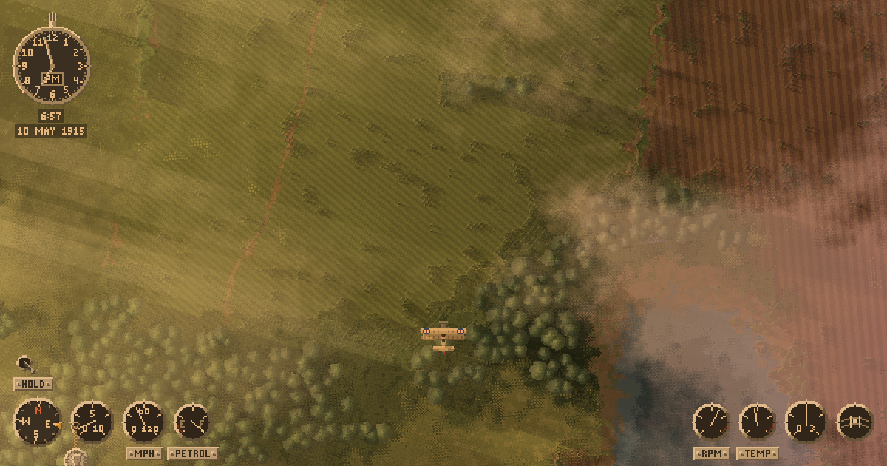
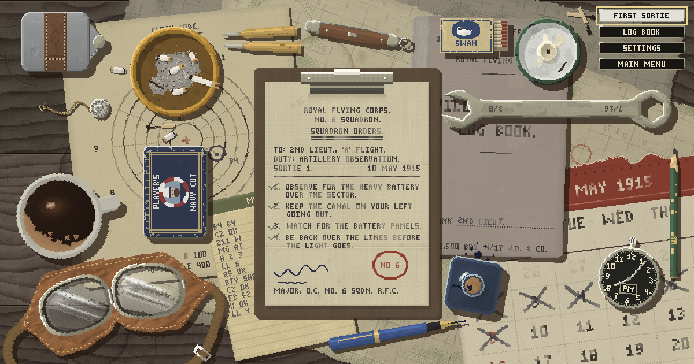
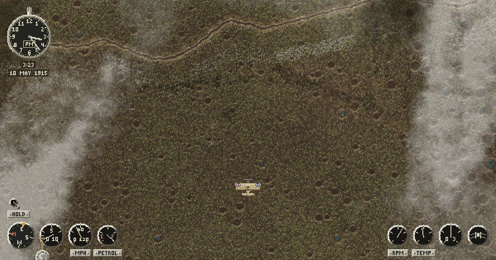

# Archie

**Fly low over the Western Front. Be home by dark.**



**[Play Archie in your browser](https://kevin-ewing.github.io/archie/)**

*Archie* is a top-down flying game set over the Western Front in 1915–16. Take the controls of a Royal Flying Corps B.E.2c, bank over trenches and farms, and watch the light change across the fields below.

## What you can play today

- **Free Fly.** Explore seeded countryside from a heading-up cockpit. Keep an eye on fuel and engine heat, use the compass to find the lines, or let the aircraft settle into hands-off flight. Fly with keyboard, mouse, or touch.
- **The Story desk.** Start at Rook Field, lift the chart, look through the orders and letters, and pick up the photograph from home. The desk is playable now. Its take-off leads into free flight while the campaign is in development.



## The story in development

You’re Tom Bell, an RFC pilot flying with an observer to help the guns find their targets. In Flanders, Arthur Vale shows you how to read the ground. In 1916, the squadron moves to the Somme and rookie observer Ned Pike takes his seat. Below, a battery contact receives your Morse and answers in cloth panels and letters. The planned campaign follows those relationships through the work of spotting for artillery, the things men send each other, and the lives they left at home.



## Development

Requires Node.js 22.12 or later.

```sh
npm install
npm run dev
```

Run the checks and production build with:

```sh
npm run check
npm run build
```

Performance checks:

```sh
npm run benchmark         # show median and p95 subsystem timings
npm run benchmark:check   # compare with the checked-in baseline
npm run benchmark:record  # append a dated run to benchmarks/history.jsonl
npm run benchmark:update  # accept a deliberate performance change
npm run verify            # tests, performance regression check, and production build
```

The regression check reports every subsystem's before/after timing and fails when both its median and p95 have slowed by more than 50%. Only update the baseline after examining and accepting the change.

Front map (internal tool for auditing and tweaking the fronts; options in [technical design](docs/TECH.md) §7b):

```sh
npm run frontmap                      # debug/1.png … 5.png: five seeds, a zoomed cross-section of the front at the plane's start
npm run frontmap -- --whole           # the whole start front instead
npm run frontmap -- --seeds=1,2,3,4,5 # pin the seeds (the previous run is kept in debug/backup/)
npm run frontmap -- --size=320000     # a wide area of many fronts instead (slow: minutes)
```

The fuller design lives in [the story bible](docs/STORY.md), [mechanics](docs/MECHANICS.md), and [technical design](docs/TECH.md).

For campaign planning and the four character dossiers and writing skills, start with the [story workshop](docs/story/README.md).
